# Overlapping Undead jaw customization

Branch `fix/undead-jaw-customization-overlap`, from develop 3e6a566c. Checked on Retail 12.1.5.70391, MoP Classic 5.5.4.70268, Classic Era 1.15.9.70003 and Classic Beta 1.60.1.70374.

## Summary

On the Undead **male**, the model's own default jaw (geoset 101) stayed visible beside every jaw the Jaw Features (MoP Classic: Features) option chose. It is a copy of the Intact jaw, so Intact looked right. Slackjawed showed the closed lips over the open jaw, Drooler showed the flesh jaw over the drool, and the bone jaws were drawn under a flesh jaw.

The cause is shared: the customization pass toggled only the geosets that some choice of an option names. A customization geoset element sets the *value of a geoset group*, so the variants of a group that no choice names were never hidden. The group's default variant (`*01`), which the default visibility rule turns on, is the one that matters. The fix hides every other variant of a group that an active choice sets.

| Client | Model | Before | After |
|---|---|---|---|
| Retail 12.1.5.70391 | Undead male HD (ChrModel 9, FileDataID 959310) | FAIL: 101 beside every jaw | PASS |
| Retail 12.1.5.70391 | Undead female HD (ChrModel 10, 997378) | PASS: no default variant in its jaw group | PASS (unchanged) |
| MoP Classic 5.5.4.70268 | Undead male (ChrModel 9, 121768) | FAIL: 101 beside every Features jaw | PASS |
| MoP Classic 5.5.4.70268 | Undead female (ChrModel 10, 121608) | PASS: no jaw geosets | PASS (unchanged) |
| Classic Era 1.15.9.70003 | Undead male (ChrModel 9, 121768) | PASS: this client's model has no 101 | PASS (unchanged) |
| Classic Era 1.15.9.70003 | Undead female (ChrModel 10, 121608) | PASS | PASS (unchanged) |
| Classic Beta 1.60.1.70374 | Undead male HD (ChrModel 9, 959310) | FAIL: as Retail | PASS |
| Classic Beta 1.60.1.70374 | Undead male Classic (ChrModel 265, 121768) | FAIL: 101 beside every jaw | PASS |
| Classic Beta 1.60.1.70374 | Undead female HD (ChrModel 10) and Classic (266) | PASS | PASS (unchanged) |
| Retail, MoP Classic, Classic Era | the other generation | UNSUPPORTED: no Classic or HD variant in these clients | UNSUPPORTED |
| every client | comparison with the in-game character screen | SKIP: no in-game capture was made | SKIP |

The captures show the stale geometry gone, and the viewport now draws exactly what the client's records select. Visual parity with the game is **not** claimed: no in-game picture of these jaws was available to compare with.

## Reproducing it

1. Load a client listed above as FAIL, then load Undead, male, from the Characters list.
2. In the Appearance panel, pick Jaw Features **Slackjawed** (MoP Classic: Features **Strapped Slackjaw**).
3. Before the fix, the closed lips of the default jaw sit over the open slack jaw. Bonejawed, Jawsome, Toothy and Unhinged show a flesh jaw over the bone jaw; Drooler and Slobber show it over the drool. Intact, Rot-Kissed and Cheeky look right, because the stray geoset there is an exact copy of the chosen one.

Reproducible example in the viewer's own state, from the harness log:

| Field | Value |
|---|---|
| Client, build | Retail 12.1.5.70391 |
| Race, gender | Undead (5), male |
| Model | `character/scourge/male/scourgemale_hd.m2`, FileDataID 959310, HD (ChrModel 9, texture layout 111) |
| Option, choice | 62 Jaw Features, 969 Slackjawed |
| Expected elements | group 1 = 3 (geoset 103), group 2 = 0 (none, 200) |
| Actual before | groups 1-2 show 101 and 103 |
| Relevant geosets | group 1: 101, 102, 103, 104; group 2: 202 (two submeshes), 203, 204, 205 |
| Visible submeshes before | 0 101 103 401 501 702 1301 1801 1901 2001 2201 2901 3001 3201 3202 3301 |
| Visible submeshes after | 0 103 401 501 702 1301 1801 1901 2001 2201 2901 3001 3201 3202 3301 |

## Root cause

`WoWModel::refresh()` first sets every geoset of the model to the default rule: geoset 0, ids ending in 01 and 32xx are shown; 17xx, 35xx and the tabard group 12xx are hidden. `CharDetails::applyCustomizationGeosets()` then took, for each option, the geosets its choices name. It showed those of the active choice and hid the rest. A geoset that no choice names was never touched.

On the Undead male, the Jaw Features choices name 100, 102, 103 and 104 in group 1, and 200, 202, 203, 204 and 205 in group 2. Geoset 101 exists in the model but no choice names it. The default rule turned it on, and nothing turned it off.

The client data treats an element as the *value* of its group (`ChrCustomizationGeoset.GeosetType`; `GeosetID` 0 means none), with one variant drawn per group:

- **Explicit "none" values.** The bone jaws set group 1 to **100** and the flesh jaws set group 2 to **200**; neither geoset exists in the model. Mag'har Orc Sideburns *None* sets 200, Eye Color *Sockets* sets 3300, and Orc Earrings *None* sets 3500. A value of none only makes sense if setting a group hides its other variants.
- **Geometry.** On 959310, geoset 101 is a vertex-for-vertex copy of 102: 768 vertices and 1250 triangles, every vertex coinciding, and a bounding-box IoU of 1.00. It occupies the same place as 103 and 104 (IoU 0.84 and 0.66). On the MoP Classic and Classic Beta SD model 121768, 101 is again a copy of 102 (and of 105/106 on Classic Beta). It is the jaw that model shows when no customization sets the group.
- **No conflicting data.** No choice in the four clients sets two variants of one group under the same gate. The one exception is a Classic Era Troll hair choice that names geosets 0 and 1, and 0 is the body.

Other hypotheses were checked and ruled out:

- **Stale geosets across selections or variant switches:** every refresh starts from the default rule, and the before logs show only the current jaw plus 101.
- **Element misinterpretation:** the jaw elements are unconditional (related choice 0), and the viewer's imported rows equal an independent read of the DB2 files.
- **Option interference:** no other Undead option sets groups 1 or 2.
- **The Unity viewport misapplying correct data:** the player draws the host's per-submesh flags, and 101 was set visible on the host.
- **Data requesting several jaws:** none does.

## Client records

**Retail 12.1.5.70391 and Classic Beta 1.60.1.70374, Undead male HD.** ChrModel 9, DisplayID 54041, FileDataID 959310. Option 62 Jaw Features:

| Choice | Name | Elements (model geoset ids) |
|---|---|---|
| 967 | Intact | 102, 200 |
| 968 | Rot-Kissed | 102, 200 |
| 971 | Drooler | 104, 200 |
| 983 | Slobber (Retail only) | 104, 200 |
| 969 | Slackjawed | 103, 200 |
| 975 | Bonejawed | 100, 202 |
| 976 | Jawsome | 100, 204 |
| 977 | Toothy | 100, 203 |
| 978 | Unhinged (Classic Beta: Toothy Slackjaw) | 100, 205 |
| 979 | Cheeky | 102, 200 |
| 980 | Loose (Classic Beta: Cheeky Slackjaw) | 103, 200 |

On Retail, Face Features is option 563: None 6287 (no geoset), Strapped 6288 (302), Rotting 6289 (303, Req 58) or 6292 (305, Req 59; these follow the jaw), Putrid 6293 (304).

**Retail Undead female HD.** ChrModel 10, FileDataID 997378. Option 67 Jaw Features:

- Intact 1037, Stitched 1038 and Cheeky 1043 set 202.
- Bonejawed 1041 sets 203.
- Toothy 1042 sets 204.

The model's group 2 is 202, 203 and 204, with no 201, so the female is not affected.

**MoP Classic 5.5.4.70268, Undead male.** ChrModel 9, DisplayID 57, FileDataID 121768.

- Option 62 Features has 17 player choices, 17601-17617. Each sets 102, 103 or 104, often with 3302 and the "none" values 200 and 300.
- Option 61 Hair Color sets 200 and 300 as well.
- Model group 1 is 101, 102, 103 and 104, and 101 is a copy of 102.

**Classic Era 1.15.9.70003, Undead male.** The same option 62 and choice IDs. This client's 121768 has only 102, 103 and 104 in group 1, so it is not affected.

**Classic Beta 1.60.1.70374, Undead male Classic.** ChrModel 265, FileDataID 121768, reached through `ChrModelAltVariant` 9 -> 265. Option 9480 Jaw Features:

- 78852 Intact, 78875 Rot-Kissed, 78876 Bonejawed, 78878 Toothy and 78880 Cheeky set 102.
- 78853 Slackjawed, 78877 Jawsome, 78879 Toothy Slackjaw and 78881 Cheeky Slackjaw set 103.
- 78854 Drooler sets 104.
- `ChrModelAltVariantChoice` maps HD 969 to 78853, 975 to 78876, and so on.

**Cross-check.** Every row above was also read straight from each client's DB2 files and models by a reader independent of the viewer. For all 22 models used in the tests, the options, choices and geoset elements, including related choices, equal the viewer's imported database.

## Implementation

`Source/games/wow/CharDetails.cpp`, `CharDetails::applyCustomizationGeosets()`:

- While collecting the active choices' geosets, each applicable element also marks its group (`GeosetType`).
- After the existing per-id pass, every own geoset of a marked group that no active choice shows is hidden. Geoset 0, the body, is never touched.
- Groups no active choice sets keep the default rule. This covers the arms, hands, feet and legs: the census below finds no body group affected anywhere.
- Several active choices that set one group are all shown, as before ("active wins").

`CharDetails.h`: the cached elements now carry their `GeosetType`, so the group comes from the record and not from `id / 100`. The one element in the data with a `GeosetID` of -1 (`ChrCustomizationGeoset` 12028, type 14, the Dracthyr drake's Breechcloth None) is "none" for group 14, not a variant of group 13.

The comments in `CharDetails.cpp` and `WoWModel.cpp` that said customization never narrows a group were brought in line.

The texture layers, the equipment pass, the ears fallback, the helmet pass, skinned (collection) models and the Unity viewport are unchanged. The Unity player and the exporters read the same per-submesh flags.

## Before and after

Head crops at native resolution of the player's 8192 x 4608 captures, with the same crop box in each strip. The Undead's idle animation moves the head slightly between captures.

Retail, Undead male: the stray flesh jaw is gone under Slackjawed, Bonejawed, Drooler, Jawsome and Unhinged.

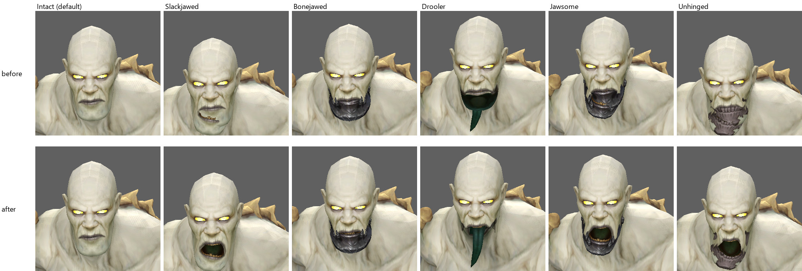

Retail, Undead female: unchanged.

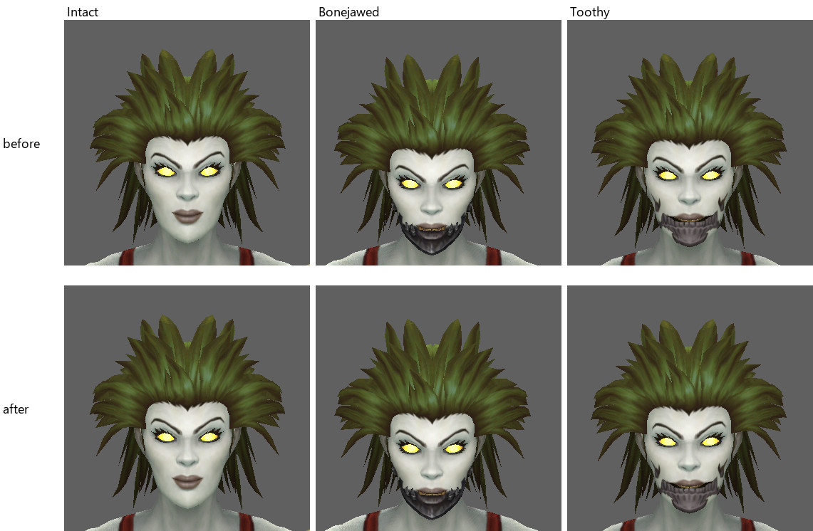

MoP Classic, Undead male (Features):

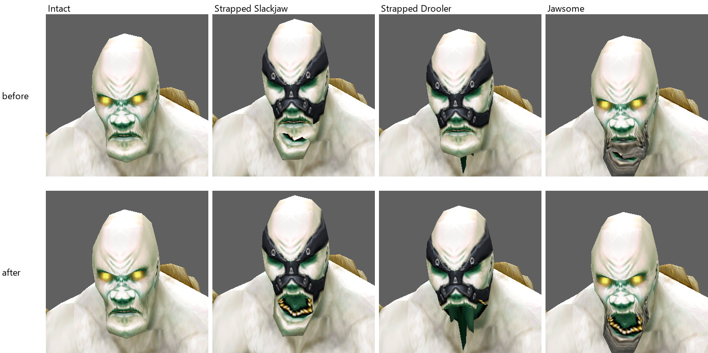

Classic Era, Undead male: unchanged; its model has no 101.

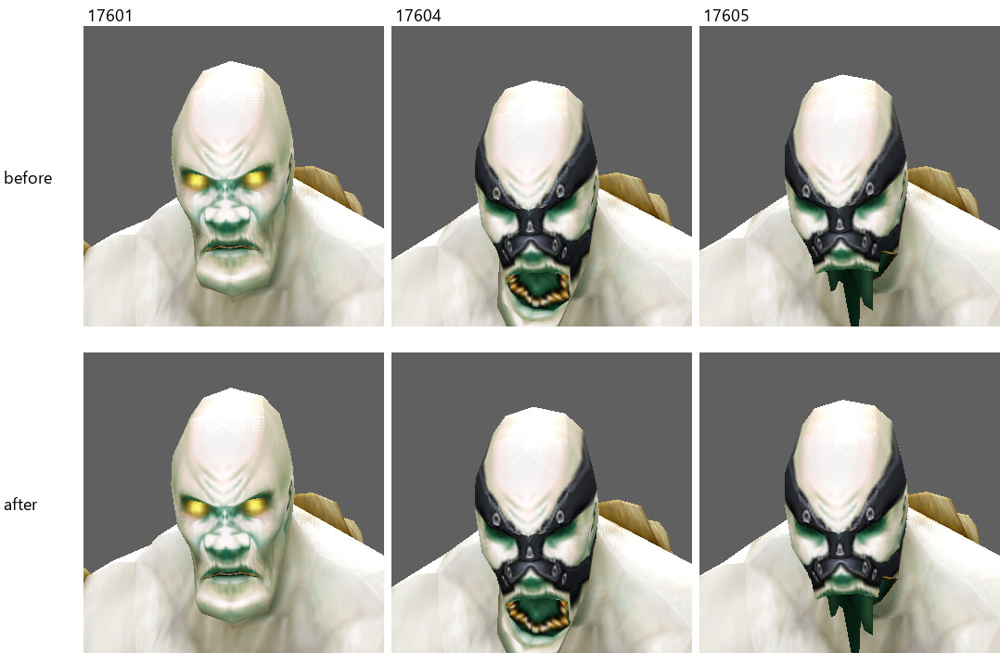

Classic Beta, Undead male HD and Classic (ChrModel 265), and the female:

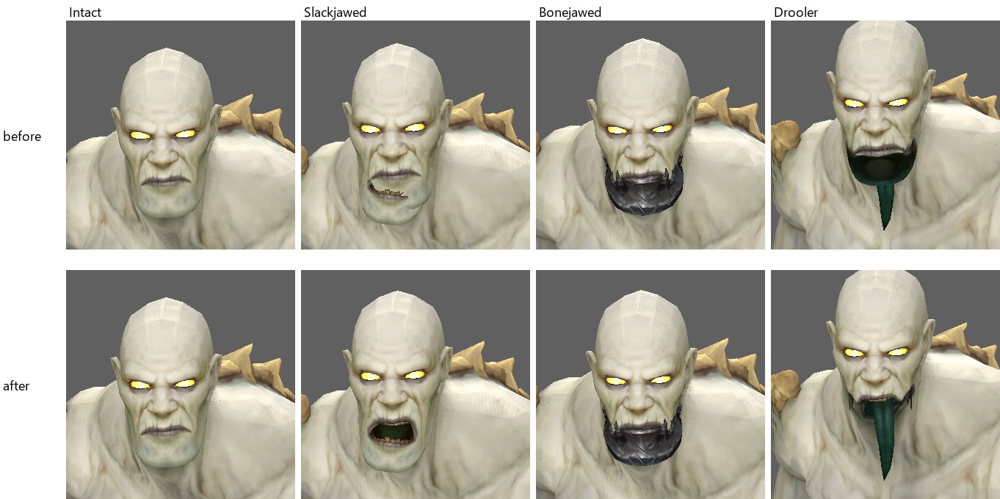
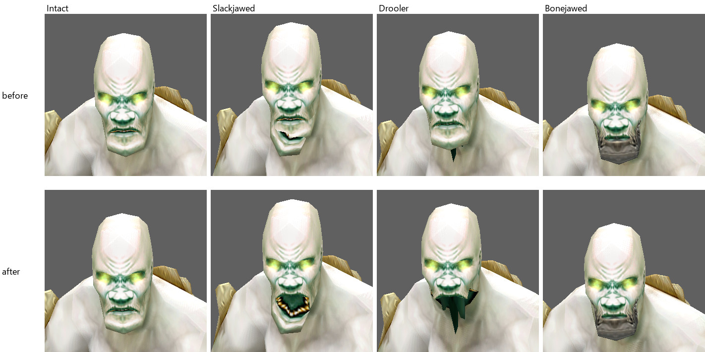
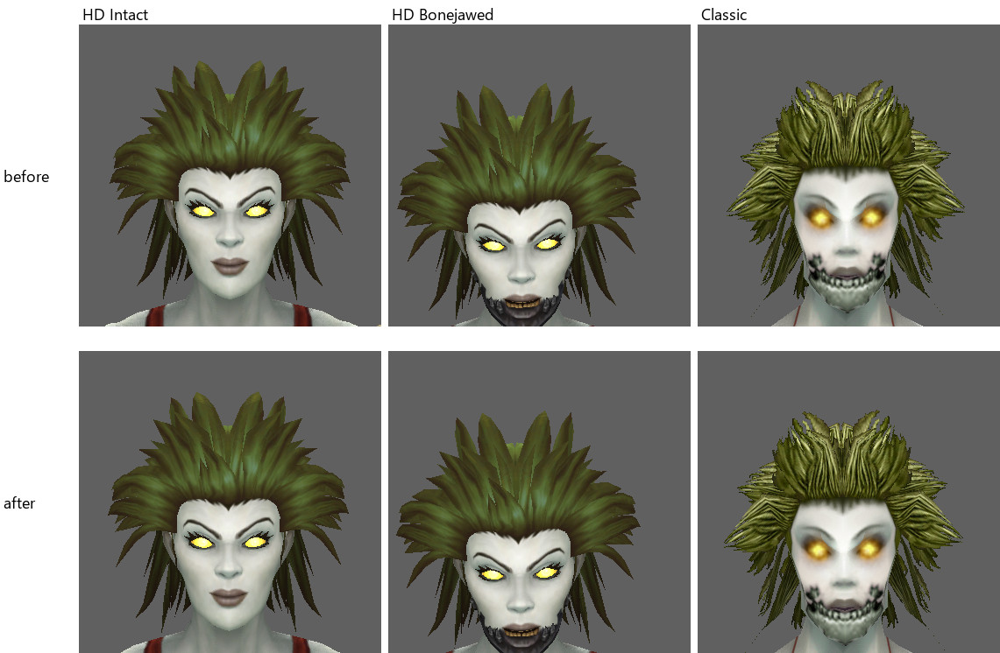

The transition sequence on the Retail Undead male, after the fix. Each old jaw disappears, and the Face Features strap from step 6 stays through the jaw change in step 7:

1. Default.
2. Jaw A: Slackjawed.
3. Jaw B: Bonejawed.
4. Jaw C: Drooler.
5. Jaw A again.
6. Face Features: Strapped.
7. Jaw: Jawsome.
8. Reset (`CharDetails::reset`).
9. Undead female, then the male again.

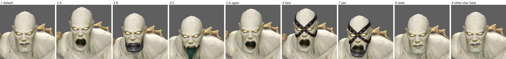

The same sequence before the fix (the before harness had no reset step):

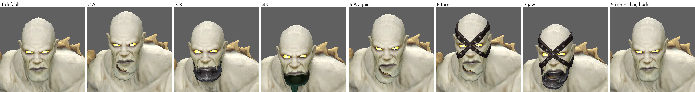

Classic Beta, Slackjawed, switched HD -> Classic -> HD with `ModelViewer::SwitchCharacterVariant`, after the fix:

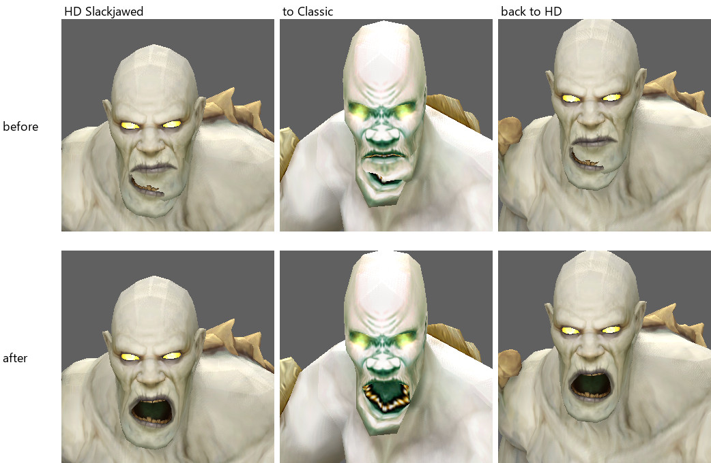

## Other races

The new pass changes only one kind of geoset. Such a geoset must be shown by the default rule, named by no element of its ChrModel, and sit in a group that some element sets. A census over every ChrModel of the four clients lists all of them.

| Kind | Where | Census |
|---|---|---|
| Default variant beside the chosen one | ears 701 (Human, Orc, Goblin, Blood Elf, Void Elf, Kul Tiran, Mag'har, Zandalari, Mechagnome, Visage, Haranir, Skyborne); face 3201 (Human, Nightborne, Haranir); horns 2401 (Draenei, Lightforged); snout 4101 (Vulpera); tusks 4001 (Zandalari female); sideburns 201 (Mag'har); hair 32 (Gilnean female; Classic Beta Human female) | every *01 hidden either repeats its variants' vertices or plugs the same socket as they do |
| Eyes under an explicit none | 3301 / 5101 under Eye Color Sockets (Undead; Classic Beta: Eye Glow None) and the NPC-only Transmog eye choices | |
| NPC races and vehicles | Tuskarr, Vrykul, Ice Troll, Northrend Skeleton, Highland Drake, Delver's Gob-Trotter, Ethereal Airship; MoP Classic Draenei female horns 101, Pandaren female tail 1901 | |

Hair 32 is shown by the default rule's `32xx` prefix test, which also matches the hairstyle id 32.

Captures, before and after:

- **Human male** (Ears Point, Face Shape Narrow): unchanged to the eye. 701 is a subset of the chosen ear, and 3201 a cap inside the head.

  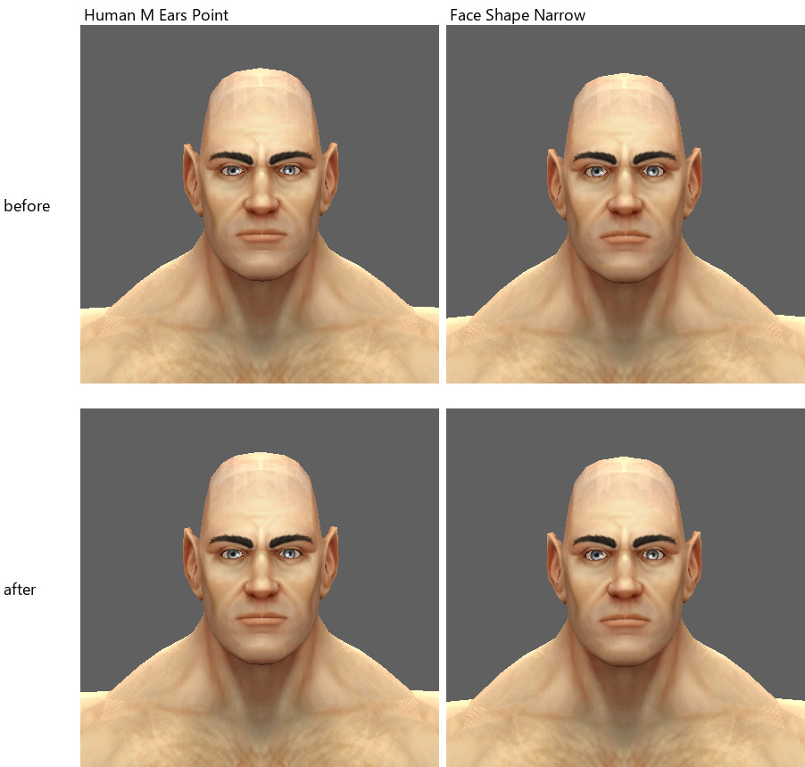

- **Blood Elf female** (Ears Long) and **Draenei female** (Horns Sweeping): unchanged to the eye.

  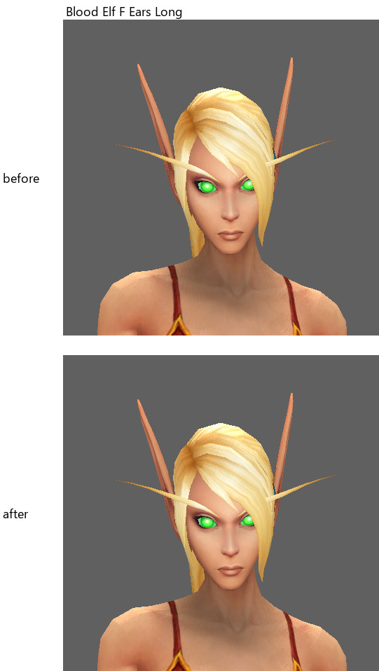
  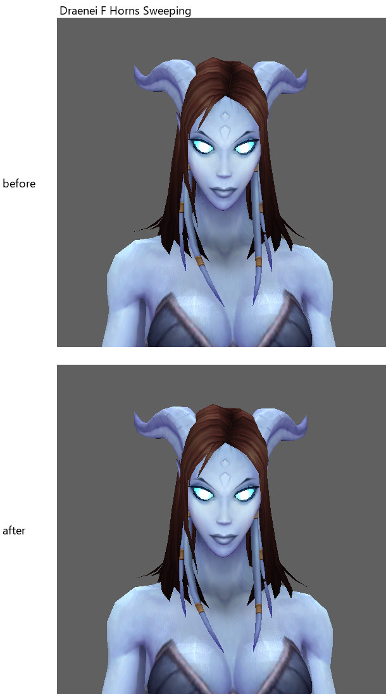

- **Vulpera male** (Snout Long): the copy of the Short snout no longer overlaps.

  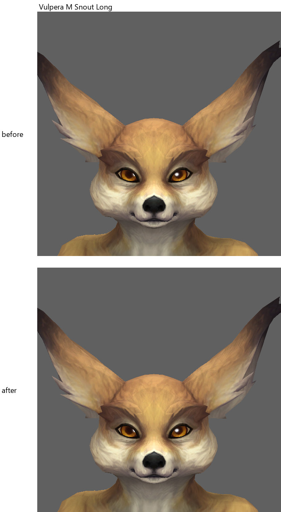

- **Mag'har Orc male**: Sideburns *None* now shows no sideburns.

  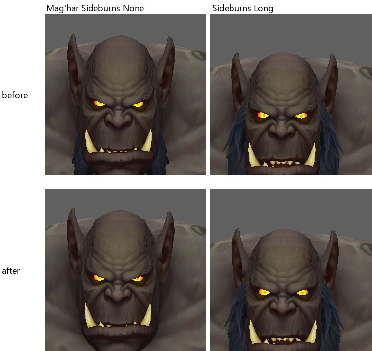

- **Gilnean female**: a second, stray hairstyle (geoset 32) is gone.

  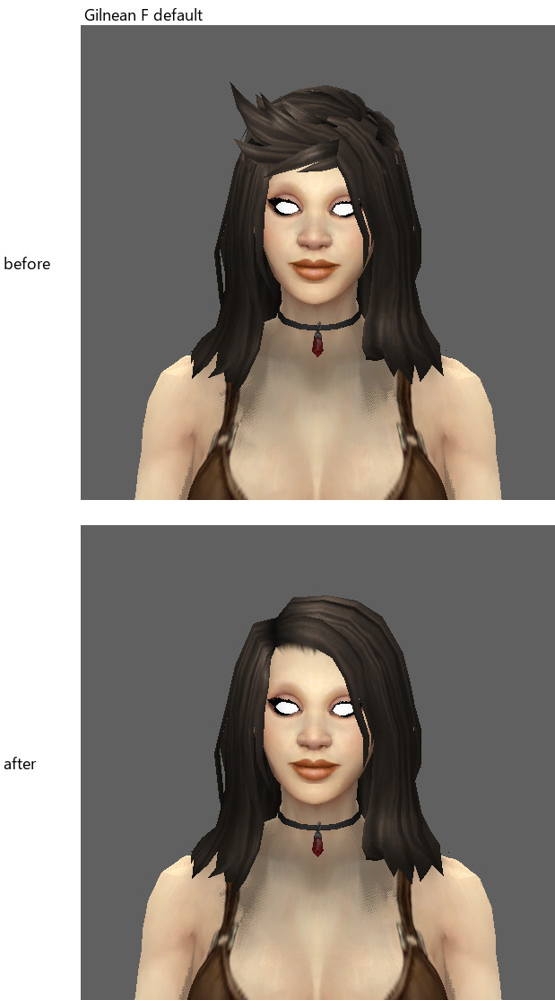

- **Undead male**, Eye Color *Sockets*: empty sockets, as the choice's 3300 says.

  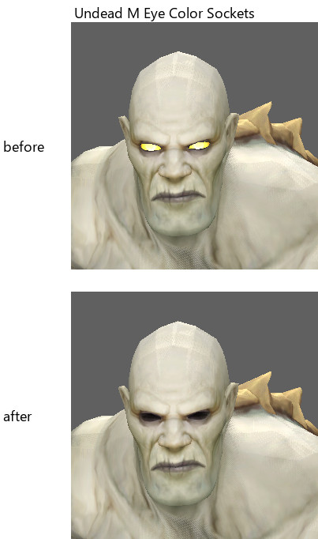

- **MoP Classic Draenei female** and **Classic Beta Human female**:

  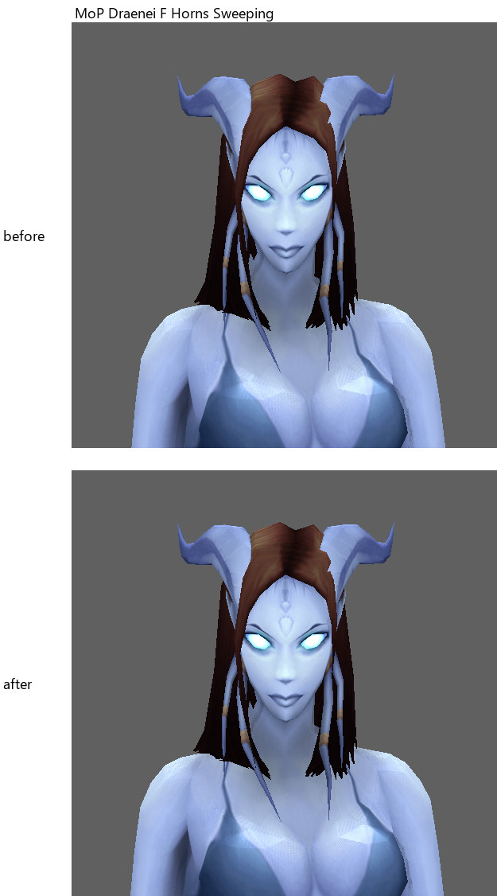
  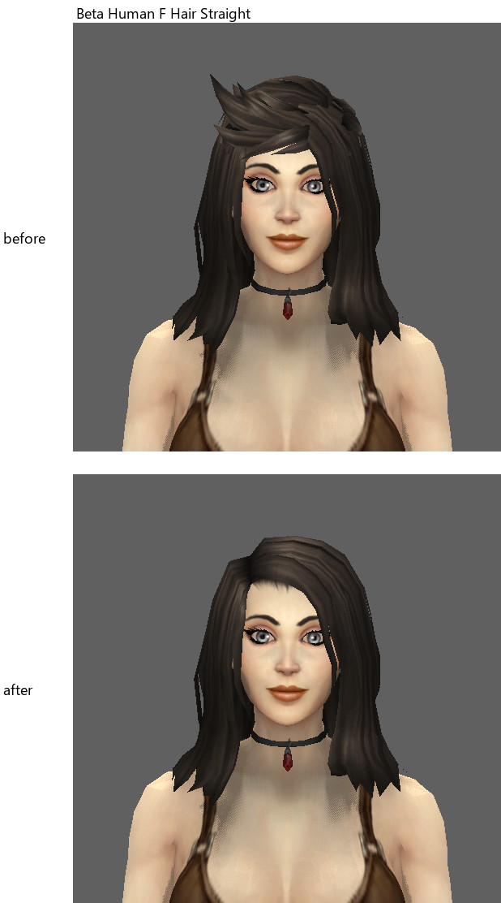

- **Controls** with nothing in the census, **Dwarf male** and **Night Elf male**: identical before and after.

  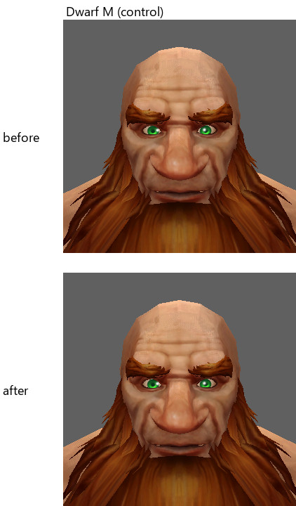
  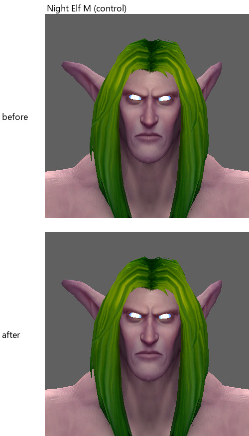

The harness logs agree: across all recorded states, the only geosets that changed are the census's, and the texture layers are identical before and after.

## Tests

**`scripts/tests/customization-geosets`** (standalone; see its README). It runs the production `applyCustomizationGeosets`, `setGeosetDisplayById`, `showGeoset` and the default rule, cut from the sources, over real records of 22 models from the four clients. Each case is checked against the picture the records give:

- every Undead male jaw on every client, written out;
- every choice of every option of every model;
- the other-race cases;
- the -1 `GeosetID` element;
- the transition sequence;
- all 24 orders of four jaws;
- 2000 random changes per model.

Result: **PASS 98/98** with the fix. Against develop's code, **FAIL 77/98**: every Undead male jaw shows 101 and every other-race case keeps its default variant, while the Classic Era Undead and the females pass.

**`-customizationtest`** (`Source/wowmodelviewer/CustomizationGeosetTest.cpp`, called from both entry points in `app.cpp`). It runs on the loaded client, through the real import, requirements and refresh:

- the Undead male's jaws against the records;
- the transitions;
- a fresh load given the same selection;
- `SaveChar` / `LoadChar`;
- `CharDetails::reset`;
- the Undead female and back;
- on Classic Beta, `SwitchCharacterVariant` to Classic and back, and the Classic model's jaws;
- every geoset choice the panel offers, on both sexes of every playable race.

The existing assertions are unchanged.

| Client | Result |
|---|---|
| Classic Beta 1.60.1.70374 | PASS, 333 passed, 0 failed, 2 skipped (the skips predate this branch) |
| Classic Era 1.15.9.70003 | PASS, 135 passed, 0 failed, 3 skipped |
| MoP Classic 5.5.4.70268 | PASS, 155 passed, 0 failed, 2 skipped |
| Retail 12.1.5.70391 | PASS, 213 passed, 0 failed, 1 skipped |

## Manual validation

| Check | Result |
|---|---|
| Each jaw choice shows its own jaw (every client, both sexes, HD and Classic) | PASS (captures and logs) |
| Switching jaws removes the old one; returning restores the earlier picture exactly | PASS |
| Another facial option (Face Features) stays through jaw changes | PASS |
| Reset | PASS |
| Another character and back | PASS |
| Classic \| HD switch and back (Classic Beta) | PASS |
| Save and load (`.chr`) | PASS (in-client test) |
| Client switch: each client's run loads its own records | PASS (the jaw records differ per client, and each run matched its own) |
| Export (OBJ, in process as File > Export) | PASS: before, every Undead male export held a `Geoset_101` group beside the chosen jaw (Retail Intact 101 102, Slackjawed 101 103, Bonejawed 101 202 202; MoP Classic Strapped Slackjaw 101 103); after, only the chosen jaw. The female export is identical before and after |
| Texture layers | unchanged in every recorded state |
| Comparison with the in-game character screen | SKIP: no in-game reference |

## Performance

- **Cost per change.** The new pass is one loop over the model's own geosets, with a stack bitset of groups and no heap allocation.
- **Per call.** `applyCustomizationGeosets` measures about 6 microseconds per call on the Retail Undead male with the fix. Develop's version measures about 6.4 microseconds, a figure that includes the measuring shim's own copying.
- **Per refresh.** A change still causes one refresh: 28 refreshes before and after on the Retail plan, 42 on Classic Beta. The refresh medians are within noise (Retail 16.5 ms before, 16.0 ms after).
- **Loading.** No extra loading, no new caches, no full reloads.

## Limitations

- **Visual parity.** It is not established. No in-game picture of these jaws was available. Some bone-jaw textures look dark in the viewport; that is texturing, unrelated to this change, and not examined here.
- **Two options, one group.** When two options set one group to different values, both variants are still shown. The only case in the four clients is the Algarian Stormrider's Saddle *Bare* (701) with a Breast harness (702). This is unchanged from develop.
- **Show Facial Hair.** Turning it off hides geoset groups 1-3 on every model, and on the Undead those groups are the jaw and the face features. This is pre-existing and not touched here.
- **Face group 3201.** The default rule still shows the whole 32xx face group on models no option sets it on, for example the Undead's 3201, an internal cap. This is unchanged.
