# World viewer 06 -- world models in the world

Branch `world/06-world-models-in-world`, from `develop` 438111b5 (Stage 05, PR #117). This document is written in the
order the work was done: the architecture first (section 1, written before any code), then the evidence, the
implementation and its verification.

Evidence grades: **PROVEN_RUNTIME** (observed in the running viewer or player on real client data), **PROVEN_SOURCE**
(read in the source or the client's own files), **INFERRED** (follows from proven facts, not observed directly),
**UNKNOWN**. Test outcomes: **PASS**, **FAIL**, **SKIP** (not run, said why), **UNSUPPORTED** (the case cannot be run
on this data or by this design, said why).

Clients (the same installation throughout; a client that updated between runs is said where it matters):

| Client | Product | Build |
|---|---|---|
| Retail | wow | 12.1.5.70391 |
| Classic Era | wow_classic_era | 1.15.9.70003 |
| MoP Classic | wow_classic | 5.5.4.70268 |
| Classic Beta | wow_classic_beta | 1.60.1.70425 |

## 1. Architecture (proposed before implementation)

### 1.1 What exists and what is reused

| Component | Today (develop 438111b5) | Stage 06 |
|---|---|---|
| `WorldMapCatalog` (host) | Map.db2 rows, the WDT rule, `MapType` 2/4 = world-model-only | unchanged |
| `MapsViewer` (host) | one map, a 64 x 64 tile grid, a target, Enter world on a tile; a WMO-only map is refused | adds the WMO-only map: its footprint, a target inside it, Enter world |
| `MapAssetWorker` (host) | one thread, whole reads, content-key MD5, a CASC lease, roles `wdt`, `rootAdt`, `tex0Adt`, `texture` | unchanged: it reads any FileDataID; the roles are decided by `decideMapAssetRequest` |
| `decideMapAssetRequest` (host) | the four roles, per-load accounting (`TerrainRequest`) | adds `obj0Adt`, `wmoRoot`, `wmoGroup`, `wmoTexture` with their own budgets |
| `UnityIpcServer` | protocol 15 | protocol 16: `loadWorld`, `worldShown`, world fields in `terrainTileLoaded`, `inspectWorldModel` / `worldModelInspected`, world counters in `runtimeState` |
| `WmvTerrainSession` (player) | one load = WDT -> root + tex0 -> textures -> one tile; exactly one report | the world load: the same, plus obj0 and the tile's WMOs, or the WDT's global WMO alone; still exactly one report |
| `WmvFlyCamera` | the free camera, keyboard on a click | unchanged; placed against the scene's origin, not a tile's |
| `WmvTerrainViewMode` | layer 30 only in the world view | unchanged; world-model instances go on layer 30 |
| `WmoParser`, `WmvWmoBuilder` (Buildings) | one WMO, built inactive, adopted by the single Buildings slot | reused unchanged per unique WMO of the scene (a prototype); instances are clones that share its meshes, materials and textures |
| `PlacementTransform` (`WorldPlacements.cs`) | the proven MODF transform, unused by the player | used for every instance; a second frame added for the WDT's global MODF (section 2.3) |
| `AdtParser.ParseObj0`, `WdtParser` (`GlobalWmos`) | parsed, unused by the player | used |

The Buildings path (`loadWoWModel` kind `wmo`, `WmvMainMapObject`) is **not** used for world models: it is one slot,
its adoption disposes whatever is on screen, frames the camera, leaves the terrain view, and fetches through the GUI
thread's `getAssetByFileDataID`. World models reuse its parser, its decode policy (only the textures a drawn material's
plan samples) and its builder, never its job or its adoption. Buildings stays byte for byte what it was.

### 1.2 The world scene

The terrain session becomes the world scene's owner. It already keys its scene by `(epoch, map)` and disposes it as a
whole (`clearTerrain`, a model load, a client switch, shutdown). Stage 06 adds to the scene:

- **One floating origin per scene**, in double. A tile scene keeps the tile's north-west corner (as Stage 03-05: every
  terrain dump, composite and reference comparison stays valid). A WMO-only scene takes the global WMO's placement
  position. Every placed object -- tile or WMO -- is converted with that one origin (`WorldToUnity.PositionD`).
- **Prototypes**: one per unique WMO FileDataID of the load (`WmvWmoBuilder.Build`, inactive, never shown).
- **Instances**: one per placement (de-duplicated by uniqueId), a clone of its prototype's object tree on layer 30,
  sharing its meshes, materials and textures, with the placement's transform (section 2.4). Destroying an instance never
  destroys shared data; a prototype is disposed after its last instance, with the scene.
- **No tile is required**: a WMO-only scene has prototypes and instances and no tile.

What does **not** change: a tile's mesh, material, textures and their build (`TerrainMeshBuilder`,
`TerrainMaterialBuilder`, `WmvTerrainBuilder`); the tile's commit; the terrain view's mask; the stage 03/04 reference
outputs. The world models are added beside the tile under the same scene root, after the tile's commit.

### 1.3 The world load

`loadWorld` (protocol 16) carries what `loadTerrainTile` carries, plus `worldModels` (place the tile's MODF WMOs),
`globalWmo` (the map is one world model: no tile) and the world-model budgets. `loadTerrainTile` is unchanged and still
loads a bare tile: the terrain harness, the older players and the stage 03/04 reference runs keep their exact behaviour.

```
loadWorld (tile)       WDT -> root ADT + tex0 ADT + obj0 ADT -> textures -> THE TILE COMMIT -> worldShown
                       obj0 MODF -> placements (de-duplicated) -> per unique WMO: root -> LOD0 groups -> sampled
                       textures -> prototype (one per frame) -> instances -> terrainTileLoaded (world "complete" or
                       "partial")
loadWorld (globalWmo)  WDT -> its MODF -> the WMO: root -> groups -> textures -> prototype -> instance
                       -> worldShown -> terrainTileLoaded (built, or failed when the world model cannot be built)
```

- **Exactly one report per load** still holds. The report of a world load comes when every placement is settled
  (built, failed, unsupported, not requested); it says how many of each, and whether the world is complete.
- **worldShown** is new: the moment the scene first has something on screen (the tile's commit, or the global WMO's
  instance) and the camera is placed. The host gives the world the viewport then (the Stage 05 rule held the camera
  until the report; a world load's report may come many seconds later). The load stays open for its world-model
  requests until the report.
- **Latest command wins** as before: a new load, `clearTerrain`, a model load or a client switch ends the load and its
  requests; late answers and worker results are dropped (the retired ring, `Dead`).

### 1.4 Serving the world-model files

All world-model files are read by the Stage 04B map asset worker, under the load's epoch and storage generation, with
the CASC strict check and the content-key MD5, through four new `getMapAsset` roles:

| Role | What | Allowed when | Kind check | Limit |
|---|---|---|---|---|
| `obj0Adt` | the tile's obj0 ADT (MODF) | once, after the WDT | `MVER` then `MDDF` | `maxAssetBytes` (4 MiB) |
| `wmoRoot` | a WMO root | after the obj0 (tile) or the WDT (global) | `MVER` then `MOHD` | 4 MiB |
| `wmoGroup` | a WMO group file | after a root was served | `MVER` then `MOGP` | 4 MiB |
| `wmoTexture` | a texture a drawn material samples | after a root was served | `BLP2` | 8 MiB |

Per load the host counts roots, groups, textures and bytes against stated budgets (section 8). The player keeps at most
four world-model requests out at once beside the tile's four (eight, under the host's queue of 16), and builds one
prototype per frame. The GUI-thread `getAssetByFileDataID` path is not used.

### 1.5 The host and the Maps viewer

- A **tile map**: Enter world sends `loadWorld` with `worldModels` to a protocol-16 player (a bare `loadTerrainTile` to
  an older one, as Stage 05). The tile comes first (worldShown), its world models follow; the panel says how many are
  placed, failed or unsupported.
- A **WMO-only map** is no longer refused. After its WDT is inspected, the global WMO's root is read by the worker and
  handed to the player (`inspectWorldModel`), whose verified parser answers with the placed world box and every group's
  box in world space (`worldModelInspected`). The overhead map then shows that **footprint** (section 5) instead of the
  tile grid; a click inside it sets the target. Enter world sends `loadWorld` with `globalWmo`.
- The host never parses a WMO, an ADT or a WDT: the player does, with the verified parsers.

### 1.6 What is out of scope

Doodads (MDDF, WMO doodad sets), liquids, lighting, sky, fog, portals, multiple tiles, streaming and a transport-wide
send cap are later milestones (roadmap 07-10). Old-form WMO-only WDTs (Retail `MapType` 4, an MWMO path that Retail's
storage cannot open) are UNSUPPORTED with a reason (section 2.5).

## 2. The placement data, verified on the four clients

### 2.1 The corpus

`Tools/world-audit/world06_corpus.py` extracts, per client, the WDTs of map 0 (775971), map 34 (Stormwind Stockade,
791060) and map 429 (Dire Maul, 780814), tile 30_47's obj0 ADT (777623), every world model those name (the obj0's
MODF records and the WDTs' global records) and their LOD0 group files, into `<audit data>/world06/<client>/` with a
manifest (build, role, size, SHA-256 of every file). `Tests/WorldModelCorpusTests.cs` checks every file against the
manifest before it reads it, so a client that updated is reported as such, never as a regression. The builds are the
table at the top of this document. (Classic Beta updated from 1.60.1.70374 to 1.60.1.70425 between Stage 05's final
battery and this one; section 17 shows what that changed.)

### 2.2 ADT MODF records: the Tile frame (PROVEN_SOURCE + PROVEN_RUNTIME)

The transform of `00-audit.md` 6.3-6.4, as `WorldPlacements.cs` implements it (`PlacementTransform`):

```
W = (32T - p[2], 32T - p[0], p[1])                  T = 1600/3, p the record's position as stored
R = Rz(a[1] + 180) * Ry(a[0]) * Rx(a[2])            a the record's angles in degrees, as stored
world = W + s * R * m                               m a model-space point, s = scale/1024 when flag 0x4 is set, else 1
```

Checked on real records, every client, tile 30_47 (`WorldModelCorpusTests`, PASS on all four):

| Client | MODF records | placements (by uniqueId) | placed root box within 0.1 yd of the record's extents | every placed group box inside the extents |
|---|---|---|---|---|
| Retail 12.1.5.70391 | 27 | 27 | 27 of 27 | 27 of 27 |
| Classic Era 1.15.9.70003 | 1 | 1 | 1 of 1 | 1 of 1 |
| MoP Classic 5.5.4.70268 | 25 | 25 | 25 of 25 | 25 of 25 |
| Classic Beta 1.60.1.70425 | 12 | 12 | 12 of 12 | 12 of 12 |

The extents are what the client stores beside the record (its own, independently computed box), so a placed root box
equal to them to 0.1 yd checks position, yaw, pitch, roll and scale at once: a wrong sign, axis order or a missing 180
degrees moves the box by tens to thousands of yards. No record on 30_47 is tilted (pitch and roll 0); every one is scale
1024 (1.0).

Then in the running player (`matrix1`, all four clients, PROVEN_RUNTIME): the bounds of every built instance, read back
from Unity and converted to the game's frame (`WmvWorldModels.RenderedWorldBox`), lie inside the record's extents for
73 of 73 placements (tolerance 0.05 yd), and within 0.05 yd of them for 52. The 21 others are inside by more because
their geometry does not reach their MOHD box: the six Stormwind city parts (48 to 229 yd: their MOHD box is larger than
the union of their groups, which the corpus test reports for the same six, e.g. Retail 328958 "its group boxes' union is
48.765 yd inside the extents (the root box fits: 0.001 yd)") and a few small models by 0.1 to 0.6 yd. Nothing is
rendered outside its record's box.

Representative records (the full list per client is in the reports' `world.list` and the host log):

| Client | Map | Tile | uniqueId | WMO | position W (x, y, z) | angles (a0, a1, a2) | scale | extents (min..max) | rendered (min..max) | outcome |
|---|---|---|---|---|---|---|---|---|---|---|
| Retail | 0 | 30_47 | 2535034 | 107001 | (-8113.509, 954.459, 58.246) | (0, 281, 0) | 1.0 | (-8162.47, 937.87, 50.99)..(-8112.05, 961.79, 78.76) | (-8162.43, 937.90, 51.02)..(-8112.09, 961.76, 78.73) | placed |
| Retail | 0 | 30_47 | 5477923 | 328958 | (-8931.634, 539.294, 101.957) | (0, 38.5, 0) | 1.0 | (-8821.18, 594.50, 71.99)..(-8399.83, 1023.12, 230.08) | (-8783.06, 595.68, 72.02)..(-8448.64, 979.05, 230.05) | placed (74 groups, 73 drawn) |
| Classic Era | 0 | 30_47 | 10047 | 107243 | (-8931.634, 539.290, 101.957) | (0, 38.5, 0) | 1.0 | (-9408.32, -25.05, 29.59)..(-8116.42, 1307.24, 378.56) | (-9200.52, 167.76, 29.62)..(-8259.12, 1254.53, 378.53) | placed (306 groups) |
| MoP Classic | 0 | 30_47 | 5543373 | 348880 | (-8931.634, 539.294, 102.025) | (0, 38.5, 0) | 1.0 | (-8984.33, 820.16, -66.74)..(-8482.11, 1322.18, 179.26) | (-8883.54, 856.18, -66.71)..(-8589.99, 1268.89, 179.24) | placed |
| Classic Beta | 0 | 30_47 | 10047 | 7962574 | (-8931.634, 539.290, 101.957) | (0, 38.5, 0) | 1.0 | (-9408.32, -25.05, 2.15)..(-7920.22, 1463.31, 378.56) | (-9200.52, 167.76, 2.18)..(-8149.58, 1438.10, 378.53) | placed (289 groups) |
| Retail | 34 | -- | 4294967295 | 108631 | (0, 0, 0) | (0, 0, 0) | 1.0 | (-8.14, -150.33, -35.55)..(197.30, 151.82, 15.22) | (-8.11, -150.30, -35.52)..(197.27, 151.79, 15.19) | placed |
| Retail | 429 | -- | 4294967295 | 109280 | (0, 0, 0) | (0, 0, 0) | 1.0 | (-387.73, -871.34, -119.99)..(927.76, 983.45, 234.61) | (-387.70, -871.32, -119.96)..(927.73, 983.42, 234.59) | placed |
| Classic Era | 429 | -- | 4294967295 | 109280 | (0, 0, 0) | **(0, 180, 0)** | 1.0 | (-387.73, -871.34, -119.99)..(927.76, 983.45, 234.61) | (-387.70, -871.32, -119.96)..(927.73, 983.42, 234.59) | placed |

(Position W is the world point the record places the model's origin at; the global records' flags are 0x8 -- the name is a
FileDataID -- with scale 1024, and no tile.)

### 2.3 The WDT's global MODF record: the Global frame (PROVEN_RUNTIME, new)

A WMO-only map's WDT (MPHD flag 0x1 on maps 34 and 429, all four clients) has one MODF record and no tile. Its position
is (0, 0, 0) on every client, so the Tile frame's `32T` offset cannot be read off the record itself: under it the
Stockade would stand at (17066.7, 17066.7, 0), under the alternative at the world origin. The specification asks for the
complete transform with evidence; the evidence is the client's own database. AreaTrigger.db2 rows of maps 34 and 429
(the dungeon's trigger volumes, positions in the game's world frame; read from the corpus's extracted tables) were
tested against the placed group boxes:

| Client | map | triggers | inside a placed group box, Global frame `W = (-p[2], -p[0], p[1])` | Tile frame | Global frame turned 180 deg |
|---|---|---|---|---|---|
| Retail | 34 | 1 | 1 | 0 | 0 |
| Retail | 429 | 8 | 8 | 0 | 4 |
| Classic Era | 34 | 1 | 1 | 0 | 0 |
| Classic Era | 429 | 8 | 8 | 0 | 4 |
| MoP Classic | 34 | 1 | 1 | 0 | 0 |
| MoP Classic | 429 | 8 | 8 | 0 | 4 |
| Classic Beta | 34 | 0 | -- | -- | -- |
| Classic Beta | 429 | 4 | 4 | 0 | 2 |

So the global record is placed with **the same rotation rule and no `32T` offset** (`PlacementFrame.Global`), and the
rule's yaw is needed (turned 180 degrees, half of Dire Maul's triggers fall outside). Two more checks tie it down:

- **The floor under each trigger** (`WorldModelGeometry.StandOn`, the camera's own rule): at all 8 Dire Maul triggers of
  Retail, Era and MoP the highest covered floor under the trigger's x and y is **at the trigger's z exactly**
  (e.g. (-55.97, 159.87): floor -3.46, trigger -3.46; (580.75, 487.51): floor 29.46, trigger 29.46). A wrong frame or yaw
  cannot put eight independent floors at eight independent heights.
- **Classic Era's Dire Maul** is the same WMO FileDataID (109280) whose file is stored turned 180 degrees about the
  vertical (its MOHD box is mirrored in x and y), and Era's record carries a1 = 180 where the others carry 0. Placed by
  the rule, the Era model coincides with Retail's: identical placed box, identical start point (-121.196, 676.238,
  -22.58) chosen from its own geometry, and the same picture from that point (section 13, pictures 9 and 9r). This is
  the Dire Maul rotation case of `00-audit.md` 6.4, verified on the current files.

The Stockade's single trigger lies inside under the Global frame on every client that has it; MoP and Era load
their own versions of WMO 108631 (26 groups, 2.7-2.9 MB, against Retail and Beta's 27 groups, 5.0 MB).

### 2.4 The rotation in Unity (PROVEN_SOURCE + tests)

Unity's frame is the game's mirrored: `(ux, uy, uz) = (-(y - Y0), z - Z0, x - X0)`, i.e. `u = M (w - O)` with M's rows
(0,-1,0), (0,0,1), (1,0,0), det M = -1. A placed point is `M (W + s R m - O)`, so the instance's local rotation is
`U = M R M^T`, which has det +1 (two reflections): a proper rotation that Unity's Quaternion can hold. It is built as
`Quaternion.LookRotation(U column 2, U column 1)` (`WmvWorldModels.UnityRotation`), and its position from the double
`W - O` (`WorldToUnity.PositionD`). The Buildings builder already converts every model vertex m to `M m` = (-m.y, m.z,
m.x) (`WowCoordinateConverter.ConvertPosition`), so the instance's U turns it to `M R m`, the converted placed vertex.
`WorldModelTests` checks det R = det U = +1 for 26 angle sets (among them (0, 180, 0), (0, 38.5, 0), a tilted
(12, 281, -4) and 20 random ones) and that U maps `M m` to `M R m` for 104 random points, to 1e-9. The end-to-end proof
is the rendered-bounds check of section 2.2: the built instances' Unity bounds, converted back, sit inside the
client's own extents for all 73 placements.

### 2.5 What is not placed (UNSUPPORTED, with the reason)

- **Old-form WMO-only WDTs**: Retail has 193 maps of MapType 4 whose WDT names its world model only by an MWMO path
  (map 1212, "Garrison - Alliance - Blacksmith 3", is the audit's example). Retail's storage root carries no names, so
  the path cannot be resolved to a file: the Maps viewer says so ("names its world model by a path only ... an old-form
  WDT, which the world view does not enter (unsupported)") and Enter world is refused with that reason (picture 14).
- **A MODF record without flag 0x8** (a name-table index; no audited client has one in an obj0, `00-audit.md` 5.6): the
  placement is "unsupported" and counted, never placed (lifecycle self-test, PASS).
- **Doodad sets** (the record's doodad-set index) are read and reported, not drawn: doodads are Stage 07.

## 3. One world frame

Every object of a world scene is converted with **one floating origin O, in double**, by
`WorldToUnity.PositionD`: `(ux, uy, uz) = (-(y - O.Y), z - O.Z, x - O.X)`, then cast to float relative to the scene
root at the identity.

- **A tile scene** keeps the tile's north-west corner as O (exactly Stage 03-05: the terrain dumps, the composites and
  every terrain reference are unchanged -- section 17). Its world models are placed with the same O.
- **A WMO-only scene** takes the global record's world position W as O (for maps 34 and 429, the world origin): the
  instance stands at the scene root's identity, and the Global frame needs no `32T` offset anywhere.
- The free camera converts its position back with the same O (`FlyWorldPosition`), so the trace, the panel and the
  camera answers speak the game's frame in both kinds of scene; the overview frames the scene's instances' union.

There is no per-building offset, no per-map position, no camera transform of its own: the Stockade is placed by its
record like every MODF record, and nothing in the code names map 34.

## 4. The world scene and the reuse of the Buildings renderer

`WmvTerrainSession` (made partial; the world half is `WmvTerrainSessionWorld.cs`) owns the scene: the tile (if any), the
world models (`WmvWorldScene`: prototypes, instances, their geometry for the camera, the scene's box), the origin, and
the load's requests and lifetime. It is still keyed by the client epoch and disposed as a whole (clearTerrain, a model
load, a client switch, shutdown). Its rules are unchanged for a tile: exactly one report per load, the latest command
wins, late answers dropped by the retired ring.

- **Prototypes.** One per unique WMO FileDataID of the load, built by `WmvWmoBuilder.Build` -- the Buildings builder
  itself, its parser, decode policy (only the textures a drawn material samples), materials and shader (`WmvWmo`) --
  kept inactive under a holder, never shown. `WmvRuntimeMapObject.LeaveLiveCount` takes a prototype out of
  `WmvRuntimeMapObject.Live` (runtimeState's liveMapObjects, which the Buildings tests hold at 1 or 0); the world counts
  it in its own tallies (`WmvWorldModels.Live*`).
- **Instances.** `Object.Instantiate` of the prototype's root: the clones' renderers share the prototype's meshes and
  materials (sharedMesh, sharedMaterials), so N placements of one model cost N transforms and renderers and one set of
  geometry and textures (lifecycle self-test: two placements, one prototype, the same sharedMesh). Instances are
  destroyed with their objects only; a prototype is disposed after its last instance, with the scene.
- **Layer 30**, the world layer: the terrain view's mask shows only it, so the model view's objects (and the Buildings
  slot) are never drawn in the world, and world objects never in the model view.
- **Light.** The world view renders no shadow maps (`WmvShadowRig` returns before them when the camera sees only the
  world layer); in that branch it now publishes the same key and fill directions the Buildings view uses, anchored to
  the camera (`AnchoredDir`), so world models are lit as Buildings lights them, without its shadows, and the same camera
  gives the same picture (never a direction left by the last model-view frame). The Buildings view does not pass
  through that branch: its picture is byte-identical (section 17).

Buildings itself is not touched: its job, slot, adoption, camera and capture are unchanged, and its regression capture
of WMO 108631 at 1600 px is byte-identical to Stage 05's (MD5 d3db7749e6831c65496c9722b5ff2632).

## 5. The overhead representation of a WMO-only map: its footprint

A WMO-only map has no tile grid and no minimap (its MAID, where present, names none). The Maps viewer now reads the
global world model's root through the map asset worker (role `mapsWmoRoot`, at most 4 MiB, the content key checked, the
kind checked: MVER then MOHD) and hands it with the WDT's record to the player (`inspectWorldModel`), whose verified
parser places it in the Global frame and answers with the placed root box and **every group's placed box** with its
MOGI flags (`worldModelInspected`). The overhead map then draws that **footprint**: the world model's box, each group's
box seen from above (interior groups -- MOGI 0x2000 -- apart from exterior ones, the higher drawn over the lower), north
up, a scale bar, the group counts and the box's extents (picture 1). A click inside the box sets the target there
(picture 2), a double-click also enters; the arrow keys move the target. Nothing of an outdoor map is fabricated.

Limitations, stated in the interface's words where they matter: the footprint is boxes, not the floor plan -- a group's
box can cover space that is not walkable, and several levels stack in one view (the Stockade's rooms, Dire Maul's
wings); a click therefore sets x and y, and the height is chosen from the geometry on entry (section 6), or typed.

## 6. The camera in the world

The free camera of Stage 05 (`WmvFlyCamera`: WASD, Q/E, Space, Shift x4, mouse look, the wheel, the native focus and
activation fix) is reused unchanged for both kinds of scene; it is placed by the player against the scene's origin.

- **A WMO-only map entered without a target**: the world model's own **start point** (`WorldModelGeometry.StartPoint`):
  among its interior groups, the one with the largest walkable floor (floor triangles: up-facing by the file's winding,
  |n.z| >= 0.7 of the normal), in it the floor triangle with the most headroom to the next surface above (at least 2.5
  yd, capped at 30), the eye 2 yd above it (less under a low ceiling), facing along the room's longer side. A covered
  floor is preferred; open sky only when no group has one. Results (corpus, all clients): Stockade (33.81, 10.53, -2.32)
  in Retail and Beta, (24.03, -8.87, -2.32) in Era, (21.56, 9.04, -2.32) in MoP -- on a floor at -4.32 under a ceiling
  at 14.5; Dire Maul (-121.20, 676.24, -22.58) on all four. Found in 6 to 16 ms.
- **With a target** (clicked on the footprint or typed): x and y as given, standing on the highest covered floor under
  them (`StandOn`; checked at every trigger, section 2.3), or at the z typed. A point outside the world model's box (give
  or take a yard) is refused with the box's extents; a point inside it with no floor of the world model under it (Dire
  Maul's box is mostly open ground between its wings: its middle, (269.2, 56.1), has none) is refused with that reason,
  and the camera stays where it was (on a first entry: the world model framed, as it is shown). Emptying X and Y removes
  the target: Enter world then goes to the start point again.
- **An outdoor tile with world models**: the target's height is the **first world-model floor at or above the terrain's
  ground** there (`GroundFloor`: the street, or a building's ground floor -- never the terrain under a city's floor,
  never a tower room or a roof only because it is covered), else the terrain's ground. The camera a load carries is
  therefore placed once its world models are settled (`owedCameraAtBuilt`), not at the tile's commit, when they do not
  exist yet. Found on Retail 30_47 at the Cathedral of Light: Stage 05's rule put the camera on the terrain at 96.9 yd,
  under the cathedral's floor at 106.5 (an unrelated floor above the camera, which the specification forbids); a
  "highest covered floor" rule put it in a tower room at 123.3. `GroundFloor` puts it on the cathedral's floor. That
  floor may be the lowest layer of a stack (steps, a dais, a floor laid twice): the point stands on the stack's top,
  climbing while the next up-facing surface of any world model there is at most the eye height plus half a yard above,
  and the nearest surface above of any world model limits the eye (adversarial review A1: before this, on a 2-yard grid
  over tile 30_47, the eye stood under a drawn floor at 1,184 of Retail's 21,692 points on a world-model floor and 665 of
  Era's 10,860; after it, at none on either). A camera asked for while the tile's world models are still settling
  (the user's next Enter world, or the camera choice) waits for them the same way (adversarial review D1).
- Nothing re-frames: the overview frames the scene once when it is shown and on the user's choice; the free camera keeps
  its place while world models arrive; the Buildings orbit camera is restored only when the world view is left.

## 7. Group culling

`WmvWorldModels.Cull`, as the main camera renders each frame in the world view (the render pipeline's begin-camera
callback, so after every camera of the frame has moved and with a capture's own aspect): an instance whose bounds are
outside the view frustum has all its groups' renderers off; otherwise each group's renderer is on exactly when its own
bounds (the group's Unity bounds, static) intersect the frustum. Only the frustum: no portal, BSP or interior/exterior rule is
applied, because none is established here (`00-audit.md`), so a group is never hidden while any of its box can be in
view -- conservative by construction. Indoor and outdoor groups are treated alike; the Buildings view is unaffected (it
culls nothing beyond Unity's own). runtimeState reports the groups, those drawn and culled, and the instances culled,
as of the last frame drawn while world models are on screen (0 otherwise, never an earlier scene's counts; section 15
for the measurements).

## 8. Serving the world-model files and the limits

Every world-model file is read by the Stage 04B map asset worker (no CASC read on the GUI thread), under the load's
client epoch and storage generation, with the strict content-key check, and answered with the key as md5, which the
player checks again before parsing. The host decides each request (`decideMapAssetRequest`, all of it covered by the
`-terraintile` in-process checks):

| Role | allowed | kind (checked on the bytes read) | read limit | per load |
|---|---|---|---|---|
| `obj0Adt` | a world load of a tile; once, after its WDT was served | MVER then MDDF | 4 MiB (`maxAssetBytes`) | 1 |
| `wmoRoot` | after the obj0 was served (a WMO-only map's: after the WDT; only the WDT's world model when the host knows it) | MVER then MOHD | 4 MiB | 64 ids, each once |
| `wmoGroup` | after a root was served | MVER then MOGP | 4 MiB | 1,024 ids, each once |
| `wmoTexture` | after a root was served | BLP2 | 8 MiB | 1,024 ids, each once |

Root and group bytes of a load are capped at 128 MiB, texture bytes at 128 MiB, both counting the reads in flight with
their limits (as Stage 04's terrain textures do). The number of reads is capped per role family: the terrain roles at
3 + 128 as before, the world roles apart at 1 + 64 + 1,024 + 1,024, so a world load's allowance never lets its WDT or
root ADT be read again past the terrain cap (adversarial review C1). A loadTerrainTile (an older player, or the
terrain harness) is served no world-model file; a WMO-only map's load no tile file. The budgets come from the census of
the four clients' tile 30_47 and maps 34 and 429:

| | largest seen | budget |
|---|---|---|
| one root file | 438,824 bytes (Beta 7962574) | 4 MiB |
| one group file | 2,432,598 bytes (Beta 7962574) | 4 MiB |
| one texture | 2,098,324 bytes | 8 MiB |
| root and group bytes of a load | about 53 MB (Beta 30_47) | 128 MiB |
| texture bytes of a load | about 48 MB counted per world model (Retail 30_47; 21 MB unique) | 128 MiB |
| unique world models | 17 (Retail 30_47) | 64 |
| group files | 306 (Era 30_47, Stormwind) | 1,024 |
| texture ids | 727 counted per world model (Retail 30_47; 215 unique) | 1,024 |
| placements | 27 (Retail 30_47) | 256 |

In the player: at most four world-model requests out at once (a parse or decode on the worker counts until done, a
texture decoded again too), beside the tile's own four, under the host's queue of 16; at most four world models fetched
at once (their parsed data held); one prototype built per frame; a load's world models time out after 120 s, the rest settled as failed. The
transport-wide cap on outgoing IPC bytes is still the inherited limitation scheduled for Stage 08: a world load is
bounded by the budgets above, but the transport itself enforces no universal bound.

## 9. Protocol 16

Host to player: `loadWorld` (everything `loadTerrainTile` carries, plus `worldModels`, `globalWmo` and the eight
budgets), `inspectWorldModel` (a WMO-only map's root and record, binary payload), the camera's `cameraStart`.
Player to host: `worldShown`, `worldProgress`, `worldModelInspected`, getMapAsset's four roles, terrainTileLoaded's
`world` object (state, every count, the timings, the placement list), mapTilesInspected's global record, runtimeState's
world tallies, culling counts and frame times.

**An older player** (protocol 15 or less) is never sent `loadWorld` or `inspectWorldModel` (`playerPlacesWorldModels`):
Enter world on a tile sends the Stage 05 `loadTerrainTile`, and the tile is shown without world models; a WMO-only map
says that the renderer in use speaks protocol N and that entering a world model needs 16, and Enter world is refused
with that reason. The player announces 16 and still takes every older message unchanged (`loadTerrainTile` loads a bare
tile: the terrain harness and every Stage 03/04 reference run use it).

## 10. Loading states, and when the world is ready

| State | where it is seen |
|---|---|
| terrain loading | the tile's phases as Stage 05 (Loading tile ...) |
| world-model requests, parsing, construction, placement | worldProgress phases "obj0", "requesting", "parsing", "building", "placing", with counts (requested, parsed, built, failed, unsupported, not requested, placed), files and bytes: the panel's line under the tile ("World models: 8 of 17 built; 10 of 27 placement(s) placed; 52 of 76 file(s) read (15.2 MB); building.") |
| scene shown | worldShown: the tile (or the WMO-only map's world model) is on screen; the world has the viewport |
| scene ready | the report: "built" with world "complete" -- every placement placed |
| partly loaded | "built" with world "partial" (and the counts of failed, unsupported, not requested): never called complete |
| no world models | "built" with world "none" (the tile places none) |
| unsupported / failed asset | a placement's state with its reason; a WMO-only map whose world model cannot be built is "failed": nothing is shown |
| cancelled / superseded | "superseded" by a newer load, "cleared" by clearTerrain or leaving Maps, the world models of the ended load disposed |

**Ready for exploration** is defined as: the scene's report "built" and the camera placed -- for an outdoor tile its
world models settled and the camera standing on their floor; for a WMO-only map its world model built (it is shown only
then). The world is visible from worldShown on (the tile framed from above, world models appearing as they are built);
the free camera is placed at the target when the scene is ready.

## 11. Lifecycle and cleanup

Every run below went through the viewer's real window on the hidden desktop (`-mapsuitest`), on the final build, and
checked the player's own counts after each step (runtimeState: world instances, prototypes, meshes, materials,
textures; live terrain tiles; the terrain view). **PASS** throughout.

| Run | What it does | Result |
|---|---|---|
| Retail round trip | enter map 34 (WMO-only); Back to map; enter again (camera inside); pick map 0 (the world model goes: 0 instances, 0 tiles); 30_47 (27 instances, 17 prototypes, 254 meshes); another tile, 31_47 (4 of 4 placed); Clear terrain (all 0); 30_47 again; Models (all 0); Maps; 30_47; Buildings with WMO 108631 (world all 0); Maps (0); map 34 again (1 instance) | **PASS** (61 checks) |
| Client switch while loading | 30_47 entered and shown with its world models still being requested, then a switch to Classic Era: no map, no tile, no world instance, and none 3 s later (no late answer builds anything into the new client's scene); 30_47 on Era (1 of 1 placed); map 34 shown, switch to MoP: 0 instances, and 0 two seconds later | **PASS** (28 checks) |
| Close during a group read | 30_47 entered; a world-model group read held in the map asset worker; the viewer closed through its window | **PASS** (8 checks); shutdown checks **9 of 9** |
| Close during a root read | map 34 entered; its root's read held; closed | **PASS** (8 checks); shutdown checks **9 of 9** |
| Close during construction | 30_47 entered; closed once the progress says "building" (Retail and Classic Beta) | **PASS** (6 and 6 checks) |
| A camera asked for while the world models settle | 30_47 entered at one point and, once shown, at the Cathedral of Light: the second camera waits for the world models (review D1) | **PASS** (13 checks): Z 108.53 on the cathedral's floor, not the terrain under it |

**Natural exit, recorded apart:** in every run the player exited on its own once the viewer asked it to ("Unity renderer
player exited after N ms"; a forced end is logged "terminated" and was never seen): 750 to 828 ms in the six runs. The Stage 05 shutdown
re-entrancy fix holds (`readshutdownserved` on all four clients in the battery: 9 of 9 each, section 17).

What these show, against the specification's list: no stale object stays visible (every count back to 0 on Clear,
Models, Buildings, another map, a client switch); no earlier client's world model reaches the new client's scene (the
counts stay 0 after the switch while answers of the old load are still arriving); shared resources go with their last
user (prototypes are disposed after their instances; 0 meshes, materials and textures after each scene); the model and
character state is untouched (Models shows its model again, Buildings its WMO; their pictures, section 13); the
player's own self-test covers the rest without a client (supersede with a late answer, a model load ending a world,
timeouts, a missing group, a bad root, a texture shared by two world models: **891 passed, 0 failed**). No double free or
use-after-free was seen: none of the runs logged an exception, and the player's object counts return to their values
before the world was entered.

## 12. The four-client matrix

The same sequence on each client (`-mapsuitest`, final build): map 34 -- its footprint, Enter world without a target
(the start point), a click on the footprint's middle (camera at the target), the fields emptied (the start point
again); map 429 likewise, with a target typed at one of Dire Maul's trigger points (its footprint's middle has no floor,
section 6); tile 30_47 at (-8515, 850). ****PASS**, 63 checks on each client**.

| Client | Build | Map 34 (WMO 108631) | Map 429 (WMO 109280) | Tile 30_47 |
|---|---|---|---|---|
| Retail | 12.1.5.70391 | complete; record at (0, 0, 0), rotation (0, 0, 0), scale 1; start (33.81, 10.53, -2.32) | complete; rotation (0, 0, 0); start (-121.20, 676.24, -22.58) | complete, 27 of 27 placed (17 world models, 259 group files, 215 textures) |
| Classic Era | 1.15.9.70003 | complete; start (24.03, -8.87, -2.32) | complete; **rotation (0, 180, 0)**, the same rendered box as the other clients; start (-121.20, 676.24, -22.58) | complete, 1 of 1 (Stormwind as one world model, 107243, 306 groups) |
| MoP Classic | 5.5.4.70268 | complete; start (21.56, 9.04, -2.32) | complete; start (-121.20, 676.24, -22.58) | complete, 25 of 25 |
| Classic Beta | 1.60.1.70425 | complete; start (33.81, 10.53, -2.32) | complete; start (-121.20, 676.24, -22.58) | complete, 12 of 12 |

Every placement's record (uniqueId, FileDataID, translation, rotation, scale), its extents and the box its instance
renders were logged by the player and the host; all **73 of 73** rendered boxes lie inside their record's extents (to
0.05 yd), 52 within 0.05 yd on every side; the vertical extent agrees to 0.03 yd on 69 and to 0.2 yd on the other 4.
Where x or y differ (21 placements, up to 229 yd), the record's extents are the larger box: they equal the world
model's placed MOHD box (to 0.1 yd, section 2.2), and that box is larger than its groups' geometry -- INFERRED: it also
covers the world model's doodads, which are not drawn here. Nothing was fabricated for a client that lacks a placement: Era's 30_47
has one record because Era's Stormwind is one world model. Unsupported formats and missing files are told apart by
state: "unsupported" (an old-form reference) and "failed" (a file the client does not have, with the storage's answer)
-- neither occurred on these four clients' cases; the unsupported case is map 1212's old-form WDT (picture 14).

## 13. Pictures

Captured inside the running viewer on the hidden desktop (`shot:` steps; the viewport as the user sees it, 1906 x 1073
window), the final build. Files in `06-world-models-in-world/`; each run's sequence is in section 16.

| # | Picture | What it shows |
|---|---|---|
| 1 | `01-map34-selected.png` | Map 34 picked: its footprint (27 groups, 26 interior), north up, scale bar |
| 2 | `02-footprint-target.png` | A target clicked inside the footprint (the cross), the panel's fields filled |
| 3 | `03-entering.png` | Enter world while the world model is read: the entering state |
| 4 | `04-inside-stockade.png` | Inside the Stockade at the target, the camera on the floor (-4.3) plus the eye height |
| 5 | `05-corridor.png`, `05b-room.png` | Another corridor, and a room at the footprint's west end |
| 6 | `06-stockade-other-angle.png` | The same world model from outside (World model overview) |
| 7, 8 | `07-08-retail-outdoor.png`, `07-08-retail-3047-overview.png` | Retail 30_47 from above the Stormwind gate, and the tile's overview: terrain and its 27 world models in one frame |
| 9 | `09-era-diremaul-start.png`, `09b-era-outdoor.png` | Classic Era: inside Dire Maul at its start point (its record turned 180 degrees in the file); Stormwind on 30_47 |
| 9r | `09r-retail-diremaul-start.png` | The same start point on Retail, for comparison |
| 10 | `10-mop-outdoor.png` | MoP Classic 30_47 |
| 11 | `11-beta-outdoor.png` | Classic Beta 30_47 |
| 12 | `12-buildings-after.png` | Buildings after the world: its WMO, alone, as before |
| 13 | `13-models-after.png` | Models after the world: its model, alone |
| 14 | `14-unsupported.png` | Map 1212: an old-form WDT, its reason in the viewport and the panel, Enter world disabled |


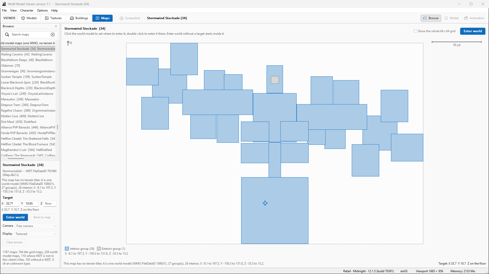

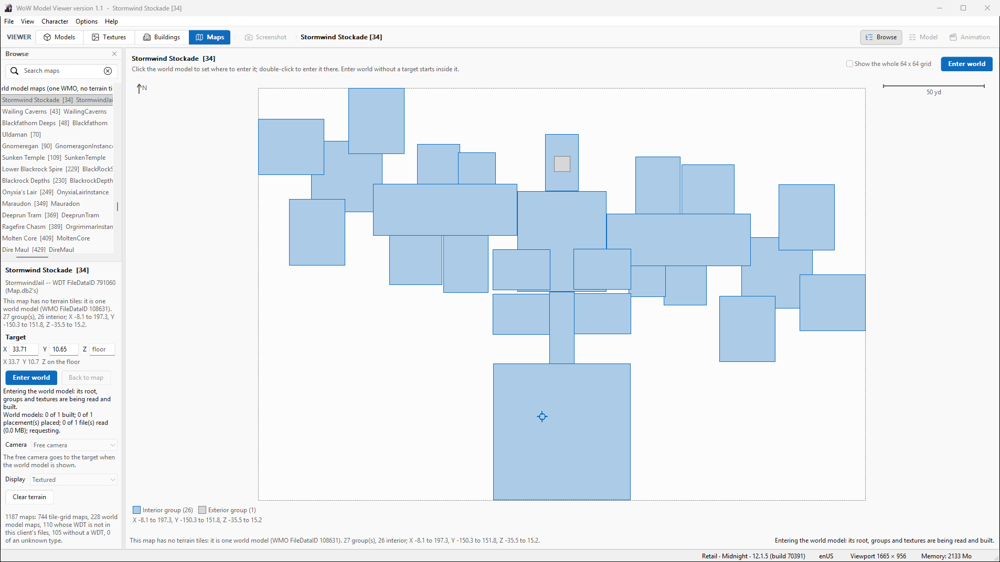

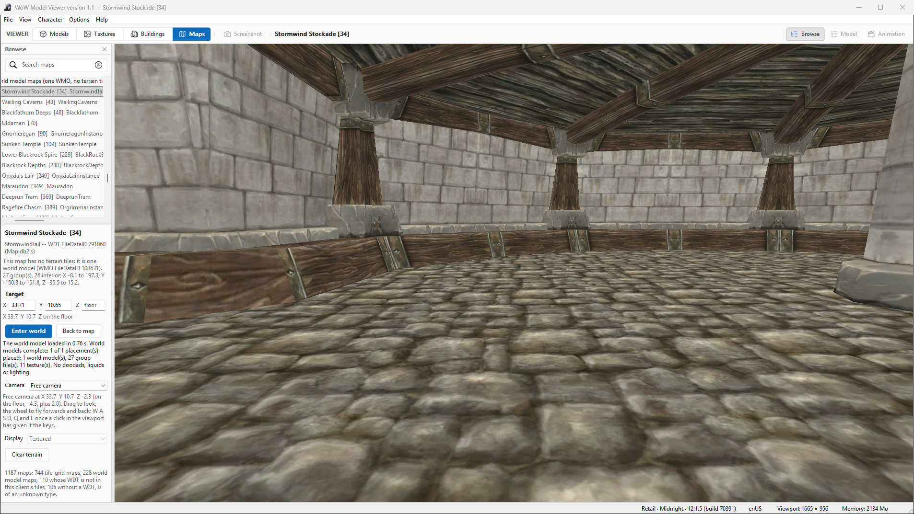

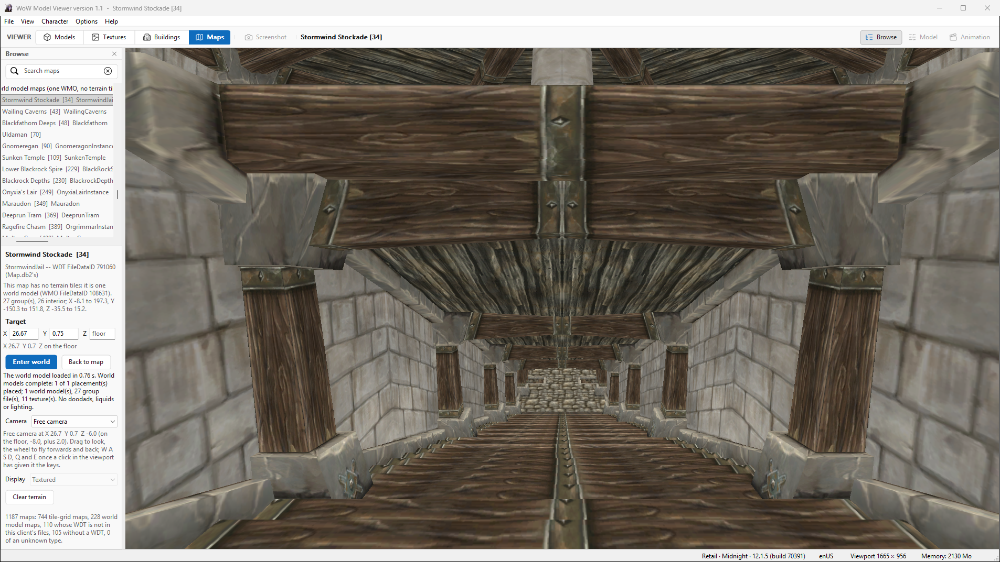

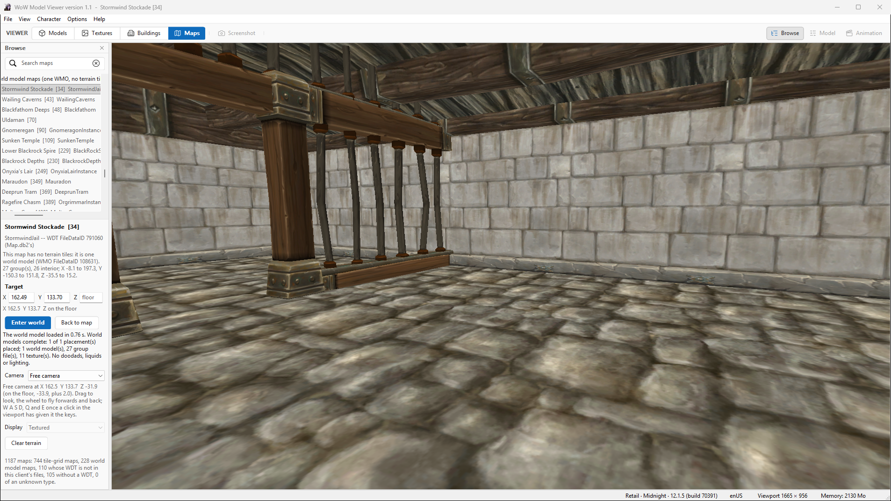

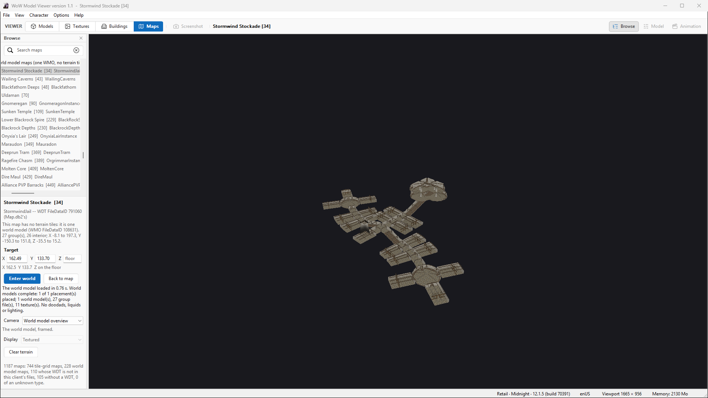

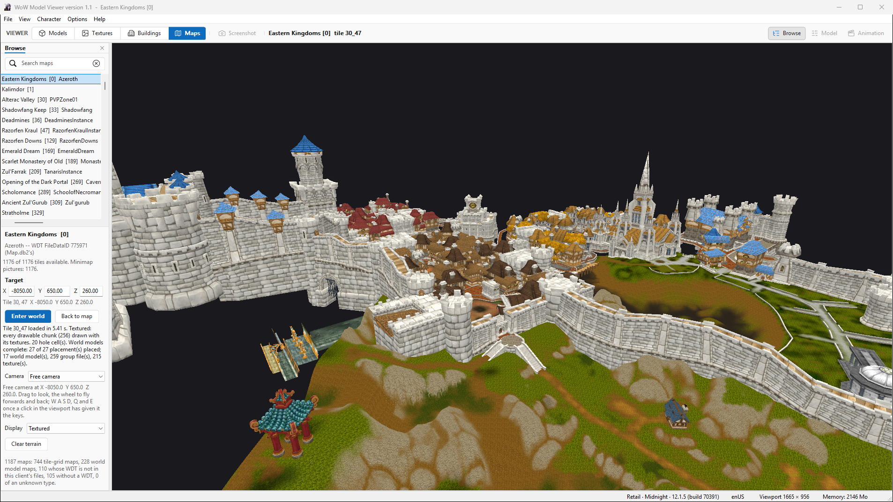

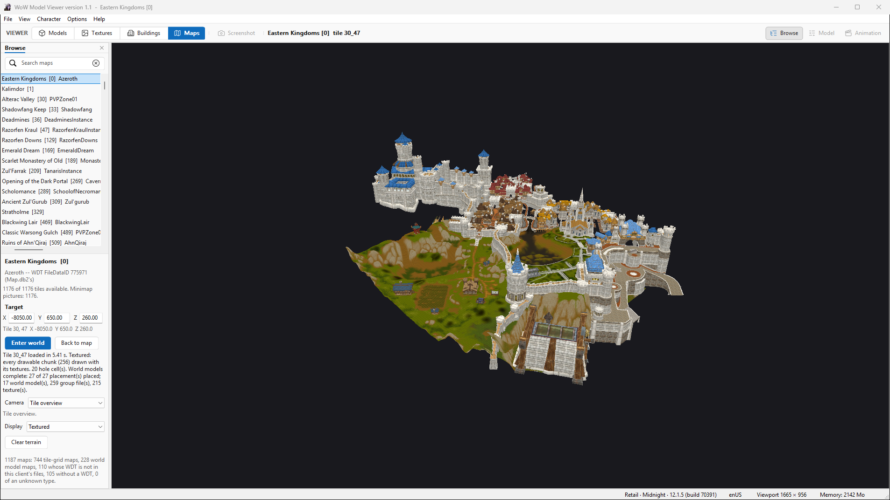

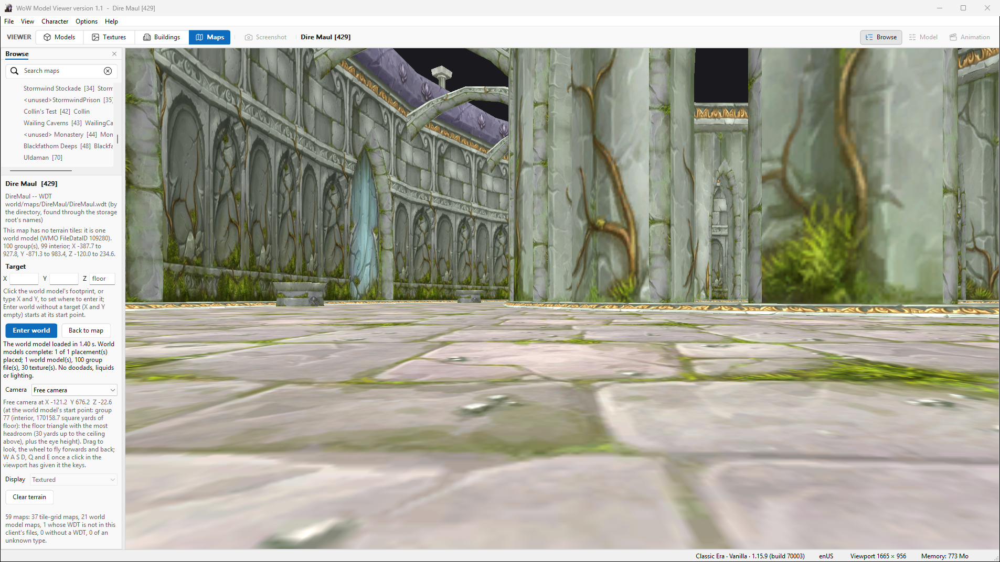

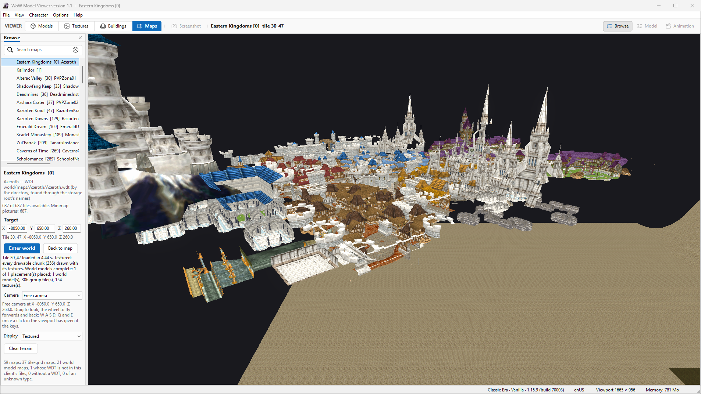


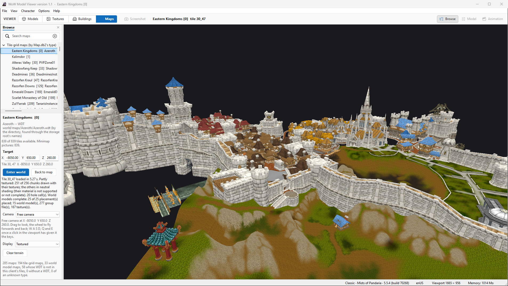

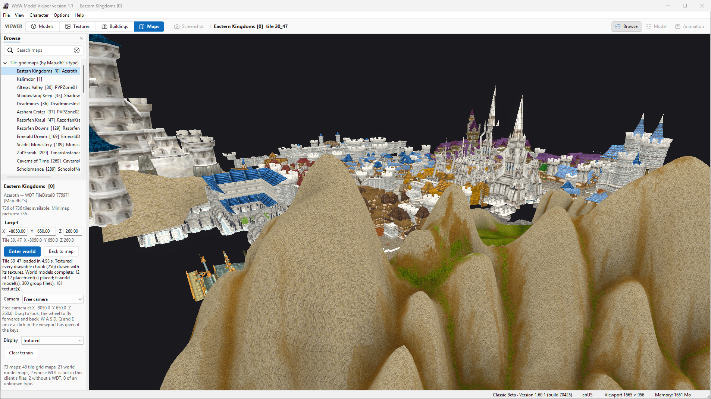

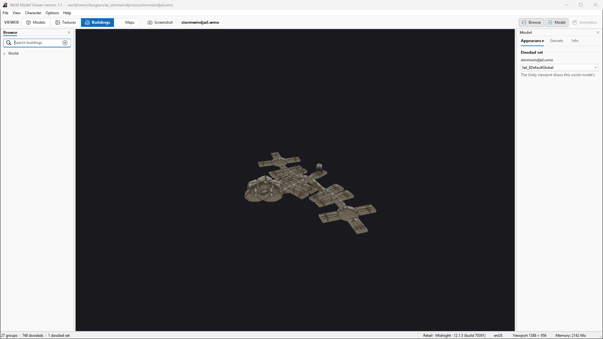

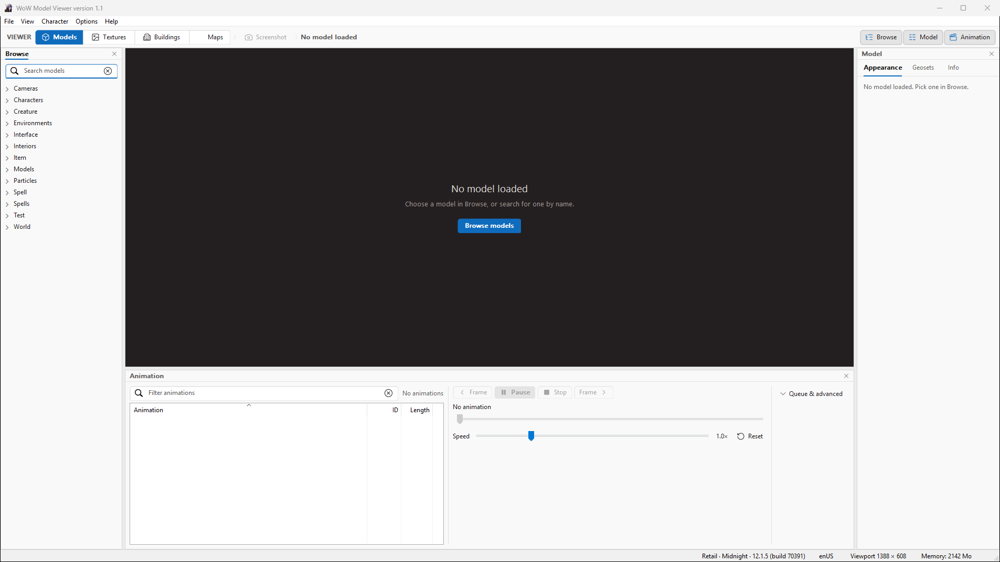

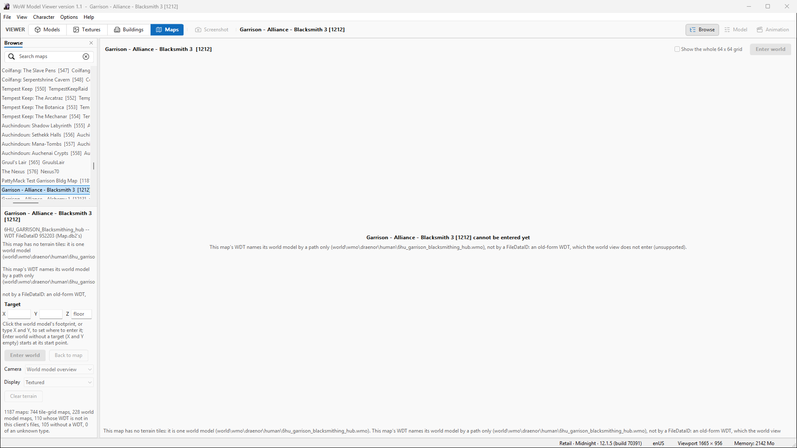

## 14. GUI and input

The final keyboard run (`-mapsuitest` with the host's input trace, the Stockade, map 34): ****PASS**, 79 checks; the camera moved as expected in 14 of 14 segments**. It posts each
key's down and up messages to the window that has the keyboard, as Windows would, with the Stage 05 free camera and
its activation fix unchanged: W, S, A, D, Q, E, Space, Shift x4 and W + D, each moving the camera the expected way and
stopping on release; keys ignored while the host's search field has the keyboard; the player given the keyboard by a
click; the keyboard taken back when the host's field is clicked mid-press (no stuck key); the same after Back to map,
Models, Buildings and Textures round trips. Latency: section 15.

Other GUI checks across the runs: the Browse list picks maps by a click on their rows; the footprint takes clicks and
double-clicks (Enter world at the point); Enter world, Back to map, the camera choice (Free camera / World model
overview), Clear terrain, the target fields (typed, Enter pressed; emptied to clear the target); the panel now grows
with its texts (the Browse pane lays it out again when a text changes its height -- before, a world load's result was
cut off under the map list's summary, seen in this stage's first pictures).

## 15. Performance and memory

One run through the real window on the hidden desktop, the final build (host and player c11), nothing else running:
map 34 entered four times (Clear between), eleven seconds still inside; Retail 30_47 entered four times, eleven seconds
still at street level; the outdoor view above the gate and the tile's overview, eleven seconds each; Models, Buildings,
Maps; a switch to Classic Era and its 30_47; back to Retail and map 34. Beside it, a sampler read the player's and the
viewer's memory about once a second (process private bytes and working set; GPU dedicated and shared memory per
process). The display's refresh is 60 Hz and the player is capped to it (Stage 05's frame-rate cap), so a steady frame is
16.67 ms. All figures PROVEN_RUNTIME.

**Loading** (the player's own report of each load; times from Enter world's request):

| Scene | World models | Shown | Settled | Read and checked (all files) | Parse | Decode (summed) | Build (summed / longest frame) | Place |
|---|---|---|---|---|---|---|---|---|
| Map 34, the Stockade (4 entries) | 1 placement, 27 groups, 11 textures, 6.4 MB of files | 0.47-0.57 s | 0.49-0.60 s | 0.37-0.44 s | 23-51 ms | 44-101 ms | 17-28 ms (one frame) | 0 ms |
| Retail 30_47 (4 entries) | 27 placements, 17 world models, 259 group files, 215 textures, 46.2 MB of files | 0.29-0.34 s | 5.38-5.40 s | 4.98-5.05 s | 93-103 ms | 1.70-1.83 s | 164-171 ms / 26-29 ms | 1.5-3.1 ms |
| Era 30_47 (Stormwind as one world model) | 1 placement, 306 group files, 154 textures, 49.3 MB of files | 0.12 s | 4.46 s | 4.13 s | 160 ms | 0.54 s | 118 ms in one frame | 0.9 ms |

The tile (terrain and textures) is on screen first; world models appear as each prototype is built (one per frame),
the free camera waiting for them (section 6). The time is in the reads: at most four world-model requests are out at
once, each a storage read on the host's worker, a content-key check, the transfer and the player's own check. The
heaviest single frame is Era's Stormwind prototype (118 ms, 306 groups in one world model): building one prototype per
frame bounds the hitch per world model, not within one. On Retail 30_47 123-129 of the 215 textures are decoded a
second time for a world model fetched after the pixels went (section 19); the decoded pixels held peak at 26.0-26.3 MB
(Era 32.7 MB, map 34 4.3 MB), never all of a load's textures at once.

**Frames** (the world view's last 600 frames, runtimeState): still inside the Stockade, at street level on 30_47, above
the gate and in the overview: median 16.67 ms, 95th percentile 16.67-16.71 ms, longest 16.8-17.0 ms -- the refresh
rate, no frame dropped. While world models are being built the longest frame is 50-80 ms (Era: 120 ms); the median
stays 16.67 ms.

**Culling** (section 7; runtimeState, the last frame): inside the Stockade 11 of 27 groups drawn; on 30_47 at street
level 51 of 265 drawn and 3 of 27 instances culled whole; above the gate 241 of 265; the overview all 265; Era's
Stormwind from the street 170 of 306.

**GPU memory of the world models** (the player's tallies): map 34 3.8 MB of geometry and 5.8 MB of textures; Retail 30_47
17.0 MB and 171.3 MB (358 GPU textures for 215 texture files: each world model uploads its own copy of a texture it
shares with another, section 19); Era's 30_47 30.3 MB and 43.9 MB.

**Process memory** (the sampler; MB):

| Step | Player private | Player working set | Player GPU dedicated | Viewer private |
|---|---|---|---|---|
| Maps, before any world | 817 | 549 | 220 | 2,231 |
| Map 34, 1st entry / 4th entry / after the 4th Clear | 1,032 / 982 / 958 | 625 / 635 / 626 | 292 / 286 / 278 | 2,237 / 2,237 / 2,246 |
| 30_47, 1st / 2nd / 3rd / 4th entry | 1,361 / 1,368 / 1,389 / 1,415 | 824 / 839 / 873 / 893 | 478 / 279 / 279 / 470 | 2,247 / 2,251 / 2,251 / 2,251 |
| Models / Buildings | 1,149 / 1,328 | 821 / 841 | 278 / 427 | 2,247 / 2,255 |
| Era switched / Era 30_47 / back to Retail | 1,325 / 1,480 / 1,356 | 841 / 900 / 856 | 427 / 509 / 447 | 1,213 / 1,943 / 2,204 |

The player's own counts return to zero after every Clear, Models, Buildings and switch (section 11), and the decoded
pixels to 0 MB at every load's end; its process memory does not fall back: the first heavy tile raises the private
bytes by about 550 MB and they stay near 1.33-1.48 GB afterwards, rising by about 55 MB over four entries of 30_47
(1,361 to 1,415 MB). INFERRED: the managed heap and the engine's allocators keep what they freed for reuse (the
counts of objects and bytes the player holds are back to zero each time); a slow leak of the same order cannot be
excluded from four entries (UNKNOWN), and is the first thing to watch when Stage 08 streams many tiles. GPU dedicated
memory moves between about 280 and 510 MB with what is drawn. The viewer's private bytes follow the client (about
2.2 GB for Retail's tables, 1.2 GB for Era's) and do not grow with world loads (2,231 to 2,251 MB over eight).

**Camera responsiveness** (the keyboard run, section 14, with the input trace): a key posted to the player's window is
taken by the player in 10 ms (median of 15 presses; at most 16 ms); the first camera trace line with the key held
follows in 32 ms (median; at most 86 ms -- the trace is written every 100 ms, so this is an upper bound).

**GUI thread**: across the performance run's 22,749 GUI rounds the longest was 351 ms, on entering Buildings (its list
is built then), then 160 ms entering Maps and 116-139 ms for the client switches; 11 rounds took over 50 ms. The
longest round of a world load's own steps was 95 ms (waiting for the world): the reads run on the map asset worker,
the GUI thread only answers and records.

**The budgets** (section 8) against what was measured: one file 4 MiB (largest seen 2.4 MB); root and group bytes 128
MiB per load (largest 42.6 MB, Era 30_47); texture bytes 128 MiB (largest 21.3 MB, Retail 30_47); 64 world models (17); 1,024 group files (306); 1,024 texture ids (215 unique, 727 counted per world
model); 256 placements (27). Every measured load is within its budgets with at least a factor of two to spare; none
was refused.

## 16. Tests and how to run them

Every GUI run below is on a separate, never-shown Win32 desktop (the established harness: the viewer and the player it
starts inherit that desktop); nothing is drawn on, takes the focus from, or captures the owner's screens. The keyboard
and mouse reach the player only as window messages posted inside that desktop.

| What | Command | New in Stage 06 |
|---|---|---|
| Pure tests (parsers, terrain, materials, world models; the corpus checks when the audit data is present) | `dotnet run -c Release --project Tools/UnityRendererProject/Tests/Runner/WowParserTestRunner.csproj` with `WMV_WORLD_AUDIT_CORPUS` naming the audit data folder | `WorldModelTests` (38 checks: both frames, the Unity rotation against a brute-force matrix, the plan's dedup and limits, MOHD/MOGI boxes, floors, StandOn, GroundFloor and its floor stacks, the start point), `WorldModelCorpusTests` (108 checks on the four clients' real bytes) |
| The corpus | `python -I Tools/world-audit/world06_corpus.py <install> <audit data> [client ...]` | new |
| Player self-test | `UnityRenderer.exe -wmvLifecycleTest -logFile <log>` | `TerrainWorldModelTests`: a global world model built and shown; supersede with a late answer dropped; a model load ending the world; tile dedup, unsupported and not-requested placements; a texture shared by two world models, the second fetched after the first was built (decoded again from its kept bytes); a timeout; a missing group; a bad root; protocol 16 |
| Host checks of the map-asset decisions and accounting | `wowmodelviewer.exe -terraintile <map> <x> <y> <out.json>` (the in-process checks run first) | the four world roles, their order rules, per-role caps, the byte budgets with reservations, terrain and world reads capped apart (a world load's WDT re-reads stop at 131), a WMO-only map's load |
| Maps GUI suite | `wowmodelviewer.exe -mapsuitest <out.json> -product <client>` with `WMV_MAPSUITEST_SEQUENCE` | steps `waitfootprint`, `clickfp`/`dclickfp`, `worldreport`, `waitshown`, `closeworld:<phase>`, `holdclose:<role>`, `target:` (emptied); expectations `footprint`, `worldstate`, `worldkind`, `placed`, `worldinstances`, `camerainworld`, `cameratarget`, `cameraz` |
| Shutdown during a read | `-terraintile ... readshutdownserved:<m>:<x>:<y>:<role>` and `-mapsuitest ... holdclose:<role>` | `holdclose` holds a world-model read in the map asset worker and closes the viewer through its window |
| Map catalogue | `-mapcatalogtest <out.json> -mapcatalogclients ... -mapcatalogprobe ...` | unchanged |
| Regression captures | `-mo creature/bear/bear.m2 -unityipctest`, `-wmo 108631 -unityipctest` with the viewport capture | unchanged |

## 17. Regression comparisons

The Stage 05 battery, run on this build (host and protocol-16 player) and compared with Stage 05's final battery on the
same client builds, file by file:

| Set | What | Result |
|---|---|---|
| Geometry dumps (`-terraintile` with `-wmvTerrainDump`, 6 tiles, 4 clients) | the terrain meshes read back from Unity | **byte-identical** for 5 of 6; Classic Beta's differs because the client updated (1.60.1.70374 to 70425) -- Stage 05's build on today's Beta data writes the same dump byte for byte (MD5 d86bd2518c7be2967cac055dd775dea3) |
| Material composites (`-wmvTerrainCompositeDump`, 98 files) | the terrain's composite textures, texel and JSON fixtures | **95 of 98 byte-identical**; the 3 different ones are Classic Beta's (the same client update): Stage 05's build on today's Beta data writes the same 3 files byte for byte as this one |
| Buildings regression capture (`-wmo 108631 -unityipctest`, 1600 px) | Buildings' picture of the Stockade's WMO | **byte-identical**, MD5 d3db7749e6831c65496c9722b5ff2632 |
| Model regression capture (`-mo creature/bear/bear.m2 -unityipctest`, 1600 px) | the model view | **byte-identical**, MD5 52605eccc2ed309c05461891e314c1da |
| Host terrain battery (H) | Stage 04B/05 worker and host checks | **PASS** except `missingtex0`, which fails as it did on Stage 05's final battery: the file it expects missing is now installed (a client-data change, not code) |
| Worker battery (W, 6 runs) | reads, memory, heavy tiles, a switch | **PASS**, 6 of 6 |
| Shutdown during a read (`readshutdownserved`, 4 clients) | the Stage 05 re-entrancy fix | **PASS**, 9 of 9 on each |
| Map catalogue (4 sequences) | the catalogue tests | **PASS** (44, 44, 27, 27 checks) |
| Pure tests | parsers, terrain, materials, world models | **PASS**, 1,801 checks, 0 failures (with the four clients' corpus) |
| Player self-test | `-wmvLifecycleTest` | **PASS**, 891 passed, 0 failed |

Stage 03/04 terrain outputs are therefore unchanged on the same data, and Buildings renders its WMOs exactly as before.
The protocol-16 player still takes every older message unchanged: the whole battery above drives it with
`loadTerrainTile`.

## 18. Adversarial review

Four independent reviewers tried to disprove the work, each given three of the specification's twelve points and the
code (not this document): A -- MODF transforms, the Global frame, bounds and coordinates, the camera inside world
models; B -- shared mesh and material ownership, group culling, scene cleanup, Buildings; C -- worker and IPC lifetime,
per-client isolation, resource limits; D -- the user interface end to end. Every finding was reproduced or argued
from the code before it was acted on.

| # | Finding (severity) | Outcome |
|---|---|---|
| A1 | On a tile, the camera could stand on the lowest layer of stacked floor surfaces, its eye under the floor in view (medium; 1,184 of 21,692 points on Retail 30_47, 665 of 10,860 on Era) | **Fixed** (section 6): the stack's top, across world models; the same measurement afterwards: 0 and 0. New tests: three layers, a layer too high to climb |
| A2 | In a terrain hole the floor limit is off, so a cellar can be chosen (low; 21 of 80 hole points, all with no other floor) | Documented: on this data the cellar is the only floor there |
| A3 | StandOn (WMO-only maps) can put the eye under an up-facing surface 2.0-2.5 yd above a floor (low; 3 of about 24,000 points) | Documented: climbing there would put the camera on a roof, which the rule exists to avoid |
| A | Not broken: the MODF rotation (derived independently from the file convention), the Unity rotation, the Global frame (the AreaTrigger test decides it), the origin and its inverses, the footprint mapping, double precision, scale, start points (16 rays each, no wall closer than 1.8 yd) | -- |
| B1 | A texture shared by two world models lost its pixels when the first was built; the second drew it white (medium-high) | **Fixed**: the file's bytes are kept for the load and decoded again for a later model, within the request gate; the pixels held peak at 26.3 MB on Retail 30_47; self-test: two models sharing a texture, the second fetched after the first was built |
| B2 | Culling ran before the cameras moved: a group could pop in a frame late, and a capture at another aspect could miss side groups (medium) | **Fixed**: culling at the main camera's render (section 7) |
| B3 | runtimeState kept the last scene's culling counts after it was gone (low) | **Fixed**: 0 when no world model is on screen |
| B4 | The world timeout could not end a load whose plan never came (low) | **Fixed**: the timeout settles it "failed", with the reason; a late obj0 answer is dropped |
| B5 | Host: a WMO-only map shown, a newer load sent before the host heard of it, and that load failing: the host believes the model view is shown (it counts tiles, a WMO-only map has none), so Screenshot could be enabled over the world (low, narrow race) | Documented (section 19) |
| B6 | A clone could leak if Instantiate's caller threw at the wrong moment (theoretical) | Documented: nothing realistic throws there |
| C1 | A world load's read allowance let its WDT or root ADT be read again about 2,200 times (medium) | **Fixed**: terrain and world roles capped apart; new checks (a world load's WDT re-reads stop at 131) |
| C2 | A non-finite number in a WMO root would make the footprint's JSON line unreadable and leave the map "Inspecting" (low) | **Fixed**: non-finite numbers go as null, and a non-finite placed box is refused with a reason |
| C3 / D3 | A failed footprint could not be retried by picking the map again (low) | **Fixed**: picking it again reads the world model again |
| C4 | The first fix of B1 kept every decoded texture of a load (up to about 1 GiB at the budget) (low) | **Fixed** with B1's final form (pixels released as before; bytes kept) |
| D1 | A second Enter world, or Free camera, while a tile's world models were still loading placed the camera at once, on the terrain under a floor not built yet (medium) | **Fixed**: the camera waits for the world models, as the load's own does; harness check `cameraz` (the Cathedral of Light: the second Enter world's camera waited for the world models and stood on the floor, Z 108.53, not on the terrain at 96.9) |
| D2 | On a WMO-only map, the start point could not be reached again once a target was set (low-medium) | **Fixed**: emptying X and Y clears the target; harness check `target:` |
| D4 | The harness's Look on a WMO-only map without a target ignores the yaw asked for (low, harness only) | Documented |
| D5 | Several harness checks could pass without the feature (`camerainworld` never compared the camera with the target) | **Fixed** for that one (`cameratarget`); the others are noted here: `clickfp` uses the painter's own formula; `waitfootprint` passes on Failed; `worldreport` passes on any report |
| D6 | The host's target box and the player's could differ by a hair at the edge (low) | **Fixed**: the player allows a yard of slack |
| D7 | "The tile places no world model." could show while the obj0 was still being read (low, transient) | **Fixed**: "the tile's placements are being read" |
| D8 | A throw in ShowWorld would leave the host "entering" (exception-only) | Documented |
| D9 | Tooltips and texts: Enter world's tooltip, the camera choice's, the Display choice enabled on a WMO-only map, the long Unsupported line clipped, minimaps paused during a world load | **Fixed** for the tooltips and the Display choice; the clipped line and the minimap pause are documented (section 19) |
| -- | Found in this stage's own pictures: the panel cut a world load's result off under the map list's summary | **Fixed** (section 14) |
| -- | Found while measuring: the decodes of B1's fix started all at once, past the request gate (an all-core burst on the heaviest tile) | **Fixed**: they wait in the same gate; the summed decode time of Retail 30_47 fell from about 23 s to 1.8 s and its load from 5.7 to 5.4 s |

## 19. Known limitations

- **No doodads, liquids, WoW lighting, sky or fog.** World models are drawn with the Buildings renderer's materials under
  its preview key and fill, without its shadow maps (said on screen). Stage 07 and later.
- **One tile at a time.** The tile's own obj0 records are placed (a world model reaching into the tile is placed when that
  tile's obj0 lists it, as the client's records do); the neighbouring tiles and their world models are not drawn.
  Streaming is Stage 08.
- **Old-form WDTs** (a world model named by path only, no FileDataID; e.g. map 1212 on Retail's table) are UNSUPPORTED,
  said in the viewport and the panel; Enter world is disabled for them.
- **The footprint is boxes**, not a floor plan (section 5); a target with no floor of the world model under it is refused
  with that reason (section 6).
- **Culling is the frustum only** (section 7): no portals, so from inside every group in view is drawn, walls between
  included. Correct, not minimal.
- **The camera's floor is the geometry's**, not the game's collision: a floor is any up-facing triangle (render and
  collision triangles alike), so a wide beam or a ledge can be stood on (INFERRED from the rule; no case was looked
  for). The free camera flies through walls (Stage 05's camera). A terrain hole lifts the "not under the ground" limit
  (review A2), and a floor 2.0-2.5 yd under another up-facing surface counts as covered on WMO-only maps (A3).
- **Textures shared between world models are uploaded once per world model** (Retail 30_47: 215 texture files, 358 GPU
  textures, 171.3 MB), and decoded again for each world model that samples them after the pixels went (section
  15). Sharing the uploaded textures between prototypes would remove both; it is not done here because it changes how
  the Buildings builder owns its textures.
- **The transport-wide cap on outgoing IPC bytes** is still the inherited limitation scheduled for Stage 08: a world load
  is bounded by the budgets of section 8; the transport itself enforces no universal bound.
- **The overhead map's minimap pictures pause during a world load** (its reads wait for the load's, as Stage 05's did for
  a tile, up to the world models' 120 s timeout).
- **The overview's one-line reason** for an unsupported WMO-only map is cut at the window's edge (the same reason is
  shown in full in the viewport's middle and in the panel).
- **Host race (review B5):** a WMO-only map shown, a newer load sent before the host heard of the first one and that
  load failing, leaves the host believing the model view is shown, so Screenshot could be enabled over the world model.
  Not reproduced; narrow.
- **ShowWorld throwing (review D8)** would leave the host "entering" until Enter world is pressed again; no case is known.

## 20. Implications for Stage 07

- The world scene owns every placed object of a load under one origin: doodads (each world model's MODS/MODD sets, and
  a tile's MDDF) can be added as instances under the same scene, sharing prototypes the same way, and are disposed
  with it.
- The placement frames are proven for MODF (tile) and the WDT's global record. MDDF belongs to the same family, but its
  rotation order and scale must be proven the same way (a runtime reference such as AreaTrigger.db2) before they are
  trusted; the corpus has no tilted MODF record, so the tilt order is derived, not observed (review A).
- The budgets of section 8 are per load and per role family; doodads need their own (M2 roots, skins, textures),
  measured on the same tiles first. The texture sharing of section 19 matters more with doodads, which reuse textures
  heavily.
- The camera's floor rules know world-model floors and the terrain; doodads should stay out of them.
- WoW lighting changes the shader inputs the Buildings renderer shares: its regression capture (MD5 d3db7749...) is the
  guard.

## 21. Acceptance gate and grades

| # | Gate (specification section 24) | Evidence | Grade | Result |
|---|---|---|---|---|
| 1 | The Stage 05 Maps interface still works | the Maps suites (sections 11-14), the regression battery (17) | PROVEN_RUNTIME | PASS |
| 2 | MapID 34 enters and shows its global WMO | matrix on four clients (12), pictures 1-6 | PROVEN_RUNTIME | PASS |
| 3 | The free camera explores its interior | keyboard run (14), pictures 4-5, camera checks (`camerainworld`, `cameratarget`) | PROVEN_RUNTIME | PASS |
| 4 | A real outdoor tile shows WMOs at their verified MODF placements | 30_47 on four clients: 73 of 73 rendered boxes inside their extents (12); the Tile frame (2.2) | PROVEN_RUNTIME + PROVEN_SOURCE | PASS |
| 5 | The Dire Maul rotation is correct | Era's record turned 180 degrees renders the same box and start point as the other clients; the triggers fall inside only under the rule (2.3) | PROVEN_RUNTIME | PASS |
| 6 | Terrain and WMOs share the world frame and origin | one origin per scene (3); the camera stands on world-model floors at the terrain's coordinates (6) | PROVEN_RUNTIME | PASS |
| 7 | Shared WMO resources have correct lifetimes | instances share meshes and materials; counts back to 0 (11); the shared-texture self-test (B1) | PROVEN_RUNTIME | PASS |
| 8 | All four clients have real-data validation | corpus tests (2), matrix (12), pictures 7-11 | PROVEN_RUNTIME | PASS |
| 9 | Buildings still renders its WMOs correctly | byte-identical capture (17), picture 12 | PROVEN_RUNTIME | PASS |
| 10 | Client switching and cancellation leave no stale geometry | switch while loading, supersede, clear (11) | PROVEN_RUNTIME | PASS |
| 11 | WMW closes safely with WMO requests active | close during a root read, a group read and construction; natural exits (11) | PROVEN_RUNTIME | PASS |
| 12 | Real input works in the embedded player | keyboard run, window messages on the hidden desktop (14) | PROVEN_RUNTIME | PASS |
| 13 | Performance and memory are measured | section 15 | PROVEN_RUNTIME | PASS |
| 14 | Actual interior pictures | pictures 4, 5, 9 | PROVEN_RUNTIME | PASS |
| 15 | Regression tests pass | section 17 (`missingtex0` fails as on Stage 05, a client-data change) | PROVEN_RUNTIME | PASS |

FAIL, SKIP and UNSUPPORTED cases of this stage: `missingtex0` (FAIL, pre-existing, client data); map 1212 and every
old-form WDT (UNSUPPORTED, by design); doodads, liquids and lighting (UNSUPPORTED, later stages). No SKIP.
